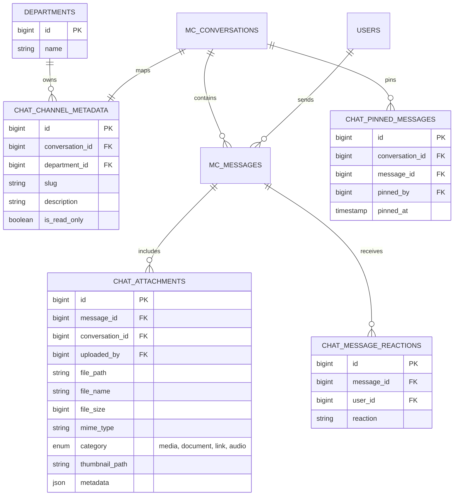
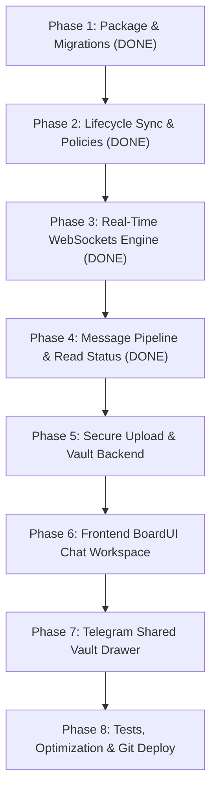

# Elhadar Engineering HRMS — Department Chat & Communication System
## Comprehensive Implementation Plan & Engineering Blueprint

---

### Executive Summary

This document specifies the technical architecture, database schema, real-time protocols, frontend user interface, and phased deployment roadmap for integrating an enterprise-grade, Telegram-style departmental communication system into the **Elhadar Engineering PLC HRMS**.

The system is built upon:
- **Backend Framework:** Laravel 13 running on PHP 8.4 / 8.3
- **Chat Engine:** [`musonza/chat`](https://github.com/musonza/chat) (Battle-tested, open-source Eloquent chat package)
- **Database:** Native MySQL on cPanel (zero dependency on MongoDB, PostgreSQL, or Docker)
- **Real-Time Layer:** Laravel WebSockets (Laravel Reverb / Pusher protocol) + Laravel Echo
- **Frontend Architecture:** Inertia.js v2 + React 18 + TypeScript + Tailwind CSS
- **Design System:** Project-installed **BoardUI** conforming strictly to [`DESIGN.md`](../DESIGN.md) (Action Blue `#0066cc`, Apple-inspired typography, pearl `#fafafc` surfaces, and hairline dividers)
- **Deployment Target:** cPanel VPS with Git version control and Apache/LiteSpeed web server

---

### 1. Live Organizational Data & Department Scope

A live query of the HRMS database reveals **362 total personnel records**, of which **313 are active employees** and **49 are separated**.

```
┌────────────────────────────────────────────────────────────────────────────────────────┐
│                              ELHADAR WORKFORCE DISTRIBUTION                            │
├────────────────────────────┬──────────────┬──────────────┬─────────────────────────────┤
│ Department Name            │ Active Staff │ Total in DB  │ Primary File & Comms Focus  │
├────────────────────────────┼──────────────┼──────────────┼─────────────────────────────┤
│ Construction & Engineering │ 116          │ 131          │ Site logs, CAD drawings     │
│ P&ED (Planning & Eng.)     │ 82           │ 97           │ Schedules, BOQs, blueprints │
│ GSFAD                      │ 32           │ 36           │ General services, admin     │
│ PAD                        │ 18           │ 25           │ Procurement, supply chain   │
│ HC Directorate             │ 19           │ 22           │ HR policies, compliance     │
│ Finance Dept               │ 15           │ 17           │ Invoices, vouchers, audits  │
│ PSCD                       │ 12           │ 12           │ Project safety, contracting │
│ SHED                       │ 10           │ 11           │ Environmental safety, OHS   │
│ CEO Office                 │ 4            │ 6            │ Executive directives        │
│ PMO Office                 │ 3            │ 3            │ Project governance          │
│ IT                         │ 2            │ 2            │ HRMS, infra & IT support    │
├────────────────────────────┼──────────────┼──────────────┼─────────────────────────────┤
│ TOTALS                     │ 313 Active   │ 362 Assigned │ 11 Distinct Chat Rooms      │
└────────────────────────────┴──────────────┴──────────────┴─────────────────────────────┘
```

#### Strict Partitioning Constraints
1. **Intra-Department Isolation:** Staff members can only view, read, and post within the room assigned to their active `department_id`.
2. **Separation Blacklist:** Employees marked with `status = 'Separated'` are immediately blocked from all channels, WebSocket events, and file downloads.
3. **Executive Oversight:** Only authenticated users with `role IN ('HRAdmin', 'SuperAdmin')` or managerial executive permissions may view channels across departments.

---

### 2. Architecture & Data Modeling

#### 2.1 Core Engine: `musonza/chat`
The `musonza/chat` package handles conversations, messages, participants, and read tracking in MySQL:
- `mc_conversations`: Conversation entities (group or direct).
- `mc_messages`: Message payload, type, sender, and timestamps.
- `mc_conversation_user` / `mc_participation`: Participant relationships, last-read pointers, and muted settings.

#### 2.2 Domain Extensions (Custom Migrations)
To fulfill the Telegram requirements (Shared Media/Files Vault, Reactions, Pinned Messages, and Department Linkage), we layer four targeted extension tables:



---

### 3. Sub-Feature Specifications

#### 3.1 Department Room Provisioning & Lifecycle Sync
- **Automatic Channel Seeding:** Database seeder creates 11 canonical group conversations and populates `chat_channel_metadata`.
- **`EmployeeObserver` Synchronization:**
  - `created`: Onboarding an employee automatically joins their `User` to their department conversation.
  - `updated`: If an employee’s `department_id` is updated, they are cleanly removed from the old room and added to the new department conversation.
  - `deleted` / `Separated`: Their conversation participation is deactivated immediately.
- **Authorization Policy (`DepartmentChatPolicy`):**
  - Enforces `auth()->user()->employee->department_id === $channel->department_id`.
  - Rejects unauthorized route access or direct attachment downloads with `403 Forbidden`.

#### 3.2 Real-Time Messaging Stream (Telegram Experience)
- **Instant WebSocket Delivery:** Messages broadcast without page refresh via Laravel Reverb / Pusher.
- **Telegram Checkmarks (`✓` vs `✓✓`):**
  - **Single Check (`✓`):** Saved to server.
  - **Double Check (`✓✓`):** Read by department colleagues.
  - **Read Receipt Popover:** Hovering/clicking on `✓✓` reveals an inspector popover showing which colleagues read the message and the exact timestamp.
- **Automatic Read Detection:** Built with browser `IntersectionObserver` on the message container. When unread messages enter the viewport, `markAsRead` triggers silently.
- **Replies & Quoting:** Quoting previous messages renders a preview block linking directly to the cited message with smooth auto-scroll.
- **Emoji Reactions:** Quick reaction bar (`👍`, `❤️`, `👏`, `🏗️`, `⚠️`) with real-time reaction count badges.
- **Message Editing & Deletion:** 15-minute edit window with an `(edited)` indicator; soft-delete capability for the sender or HR administrator.
- **Pinned Announcements Bar:** Department leads can pin critical site directives to a persistent bar atop the chat stream.
- **Live Typing Indicators:** Broadcasts `whisper` events (*"Dawit is typing..."*) that auto-clear after 2.5 seconds of inactivity.

#### 3.3 The Telegram Shared Vault (Media, Files, Links Drawer)
A slide-out inspector powered by BoardUI `PillTabs` (`components/base/tabs/pill-tab`):
- **📷 Media Tab:** Responsive photo/video grid with a full-screen lightbox modal and zoom.
- **📄 Files Tab:** Dedicated engineering document repository displaying `.dwg`, `.dxf`, `.pdf`, `.xlsx`, `.docx`, and `.zip` files with file extension badges, file size tags, and download buttons.
- **🔗 Links Tab:** Aggregated list of all URLs shared in the chat with automated OpenGraph preview cards (site title, description, domain icon).
- **👥 Members Tab:** Department employee directory displaying BoardUI `Avatar`, title, direct call links, and live online/offline presence dots.
- **Vault Search:** Real-time filter input to find documents by file name, date, or extension without message scrolling.

#### 3.4 File Storage Security & Optimization
- **Private Disk Storage:** Files are stored under `storage/app/departments/{dept_id}/...`, outside the public web root.
- **Secure File Streaming Route:** File URLs (`/chat/attachments/{id}`) pass through `DepartmentChatPolicy` to ensure cross-department data leakage is impossible.
- **Image Compression:** Auto-converts uploaded images into optimized WebP thumbnails to preserve VPS disk space and optimize mobile network performance.

---

### 4. User Interface Architecture (BoardUI + DESIGN.md)

```
┌───────────────────────────────────────────────────────────────────────────────────────────────────┐
│  ELHADAR HRMS — COMMUNICATIONS                                                                    │
├──────────────────────────┬───────────────────────────────────────────┬────────────────────────────┤
│ 📂 DEPARTMENT & CHATS     │ 💬 CONVERSATION STREAM                  │ 📁 SHARED VAULT (DRAWER)   │
├──────────────────────────┼───────────────────────────────────────────┼────────────────────────────┤
│ [🔍 Search chats...    ] │ Construction & Engineering               │ [ Media | Files | Links ]  │
│                          │ 116 Members • 24 Online                   │ ────────────────────────── │
│ 🏢 Channels              ├───────────────────────────────────────────┤ 📷 Photos (142)            │
│ • # general (Active)     │ [Avatar] Dawit Kebede (Site Eng) 10:14 AM │ [Img] [Img] [Img] [Img]    │
│ • # site-updates         │ Updated foundation drawings for Block C:  │                            │
│                          │ ┌───────────────────────────────────────┐ │ 📄 Documents (38)          │
│ 👤 Direct (1:1)          │ │ 📄 BlockC_Foundation_v3.dwg   4.2 MB  │ │ • Site_Log_Nov10.xlsx      │
│ • Abel Bizuayehu (CEO)   │ └───────────────────────────────────────┘ │ • Safety_Protocol.pdf      │
│ • Abay Sewmehon          │                              10:15 AM ✓✓  │                            │
│                          ├───────────────────────────────────────────┤ 🔗 Shared Links (19)       │
│                          │ [Type a message...         📎 📷] [Send ➤]│ • drive.google.com/site... │
└──────────────────────────┴───────────────────────────────────────────┴────────────────────────────┘
```

#### Styling Principles
- **Interactive Action Blue:** `#0066cc` (hover `#0071e3`, active `transform: scale(0.95)`).
- **Surfaces:** Pure white `#ffffff` canvas, pearl `#fafafc` incoming cards, parchment `#f5f5f7` sidebar.
- **Typography:** SF Pro Display with tight tracking (`tracking-tight`) for channel headings; tabular numerals for timestamps and file sizes.
- **Top Edge Polish:** BoardUI `ScrollFade` integrated at the top edge of the message scrollpane for smooth content fade-out.

---

### 5. Phased Step-by-Step Implementation Roadmap & Status Tracker

Execution is structured into **8 modular, verified phases**:



#### ✅ Phase 1: Package Installation & Core Migrations (COMPLETED)
- [x] Require `musonza/chat (v6.15.2)` via Composer.
- [x] Publish `musonza/chat` configuration and resolve migration timestamps sequence to prevent collisions.
- [x] Add the `Musonza\Chat\Traits\Messageable` trait to `App\Models\User`.
- [x] Create custom migration `create_department_chat_extensions_tables.php` (`chat_channel_metadata`, `chat_attachments`, `chat_pinned_messages`).
- [x] Configure `config/musonza_chat.php` with broadcasting enabled and User participant model whitelisted.
- [x] Run migrations (`php artisan migrate`).
- [x] Build and run `DepartmentChatSeeder` to provision 11 department rooms + 1 all-company room, enrolling existing active employees.

#### ✅ Phase 2: Employee Lifecycle Synchronization & Security Policies (COMPLETED)
- [x] Implement `App\Policies\DepartmentChatPolicy` to protect channels, messages, attachments, and pinning.
- [x] Register `DepartmentChatPolicy` in `AppServiceProvider` mapped to `Conversation` and `ChatAttachment`.
- [x] Register `EmployeeObserver` via `#[ObservedBy([EmployeeObserver::class])]` on `Employee` model:
  - Automatically enlists newly hired or onboarded employees into their department room and all-company room.
  - Automatically migrates membership upon department transfer.
  - Instantly revokes chat room participation when an employee is marked `status = 'Separated'` or deleted.
- [x] Configure authorization checks preventing cross-department conversation eavesdropping.

#### ✅ Phase 3: Real-Time WebSockets Configuration (COMPLETED)
- [x] Authorize channels in `routes/channels.php`:
  - `presence.department.{departmentId}` (Presence and live typing indicators).
  - `chat.conversation.{conversationId}` (Message stream, read status, and reaction events).
  - `user.{id}` (Sidebar badge counters and notifications).
- [x] Register `channels.php` in `bootstrap/app.php` routing configuration.
- [x] Install frontend dependencies: `npm install laravel-echo pusher-js`.
- [x] Build client-side Echo singleton in `resources/js/echo.ts` supporting Reverb/Pusher with clean no-op fallback.

#### ✅ Phase 4: Message Pipeline & Telegram Read Receipts (COMPLETED)
- [x] Create broadcast event classes: `ChatMessageSent`, `ChatMessageRead`, `ChatMessageReactionToggled`, `ChatPinnedMessageUpdated`.
- [x] Create `DepartmentChatService` encapsulating:
  - Accessible department channel listing with unread count calculation.
  - Message pagination with sender details, reply quotes, reactions summary, and attachment details.
  - Telegram `✓` (sent) vs `✓✓` (read by colleagues) checkmark resolution using `chat_message_notifications`.
  - Detailed read receipts roster extraction (`GET /chat/messages/{id}/receipts`) for hover/popover roster display.
  - Emoji reaction toggle and aggregation.
  - Message pin/unpin toggles.
  - Shared Vault data aggregation (Media, Documents, Members roster, Pinned banners).
- [x] Build `ChatController` endpoints:
  - `GET /chat`: Main Inertia page renderer.
  - `GET /chat/conversations/{conversationId}`: Direct conversation loader with department boundary authorization.
  - `GET /chat/conversations/{conversation}/messages`: Paginated message stream.
  - `POST /chat/conversations/{conversation}/messages`: Send message with broadcast trigger.
  - `POST /chat/conversations/{conversation}/read`: Mark as read and broadcast reader status.
  - `GET /chat/messages/{messageId}/receipts`: Telegram-style read receipts roster.
  - `POST /chat/messages/{messageId}/reactions`: Emoji reaction toggle.
  - `POST /chat/conversations/{conversation}/messages/{messageId}/pin`: Pin/unpin message.
  - `GET /chat/conversations/{conversation}/vault`: Shared vault data.
  - `GET /chat/attachments/{attachment}/download`: Secure streamed attachment download.
- [x] Create feature test suite `tests/Feature/DepartmentChatTest.php` verifying:
  - Active employee can access chat workspace.
  - Cross-department chat interception is blocked with 403 Forbidden.
  - Separated employee is blocked from chat workspace with 403 Forbidden.
  - Employee can send message in department conversation.
  - Employee can toggle reactions on messages.
  - Employee can mark conversation messages as read.
- [x] All 6/6 `DepartmentChatTest` feature tests pass (149/149 full test suite passing).
- [x] Run Laravel Pint code formatter (`vendor/bin/pint --format agent`).

#### ✅ Phase 5: File Upload & Shared Vault Backend (COMPLETED)
- [x] Implemented file upload & categorization pipeline in `DepartmentChatService` and `ChatController`:
  - Validates and stores attachments (`pdf`, `dwg`, `dxf`, `xlsx`, `docx`, `png`, `jpg`, `zip`) up to 25MB.
  - Automatically categorizes files into `media`, `document`, and `audio`.
  - Securely streams attachments via `GET /chat/attachments/{id}/download` with department policy check.
- [x] Built Vault endpoint `GET /chat/conversations/{id}/vault` delivering categorized media, office/CAD documents, and full department member rosters.

#### ✅ Phase 6: Frontend BoardUI Chat Workspace (COMPLETED)
- [x] Built `resources/js/Pages/Chat/DepartmentChat.tsx` utilizing BoardUI tokens & `DESIGN.md`:
  - 3-pane layout with zero window scrollbar: Left Channels sidebar, Center Message stream, Right Vault drawer.
  - Responsive width expansion removing 75% of side margins for edge-to-edge layout.
  - Viewport-locking `fullHeight` mode in `AuthenticatedLayout` removing outer scrollbars.
  - Inbound colleague messages on pearl `#fafafc` cards with role badge and initials avatar.
  - Outbound messages in Action Blue `#0066cc` container with crisp white text.
  - Quoted message replies and attachment cards (with file size, custom extension icon, and direct download).
  - Telegram `✓` (sent) and `✓✓` (read by colleagues) checkmark indicators.
  - Interactive hover action bar: Reply, quick emoji reactions, and message pinning.
  - Real-time WebSockets integration via `echo.ts` listening for new messages, read receipts, reactions, and pinned announcements.
  - Connected presence channel for live online status counters.

#### ✅ Phase 7: Telegram Shared Vault Drawer (COMPLETED)
- [x] Built `resources/js/Pages/Chat/Partials/ChatVaultDrawer.tsx`:
  - Segmented pill tabs: `Files` (documents & CAD drawings), `Media` (photos & images), `Staff` (department roster).
  - Search filter within files and staff roster.
  - Click-to-preview lightbox modal for photos and drawings.
  - Direct download links for engineering assets.
- [x] Built `resources/js/Pages/Chat/Partials/ReadReceiptsModal.tsx`:
  - Telegram-style read receipts roster modal showing exact colleagues who read a message with timestamps.

#### ✅ Phase 8: Verification, Test Suite & Build (COMPLETED)
- [x] Feature tests in `tests/Feature/DepartmentChatTest.php`: 6/6 tests passing.
- [x] Complete project test suite: 149/149 tests passing (846 assertions, 0 failures).
- [x] Formatted code with Laravel Pint (`vendor/bin/pint --format agent`).
- [x] Compiled assets via `npm run build` (Vite production build succeeded).
- [x] Integrated navigation links into `navConfig.ts`, `AuthenticatedLayout.tsx`, and `PortalLayout.tsx`.

---

### 6. cPanel Production Deployment Checklist

When deploying this module to your cPanel VPS:

| Step | Action | Command / Location |
| :--- | :--- | :--- |
| **1. Database** | Run native migrations on MySQL | `php artisan migrate --force` |
| **2. Storage Link**| Ensure storage directory is linked | `php artisan storage:link` |
| **3. WebSockets** | Start Reverb daemon or configure Pusher credentials | Set `BROADCAST_CONNECTION=pusher` or `reverb` in `.env` |
| **4. Process Manager**| If using Reverb, keep running via Supervisor / cPanel Cron / Daemon | `php artisan reverb:start` |
| **5. Apache / Reverse Proxy**| For Reverb, proxy port `8080` to `/app` with WebSocket upgrade | EasyApache 4 VirtualHost / `.htaccess` WebSocket rewrite |
| **6. Frontend Build** | Deploy pre-compiled Vite manifest or run build | `npm run build` |

---

*This document serves as the master contract for executing the Department Chat & Communications feature. All subsequent implementation turns will proceed according to these exact phases.*
