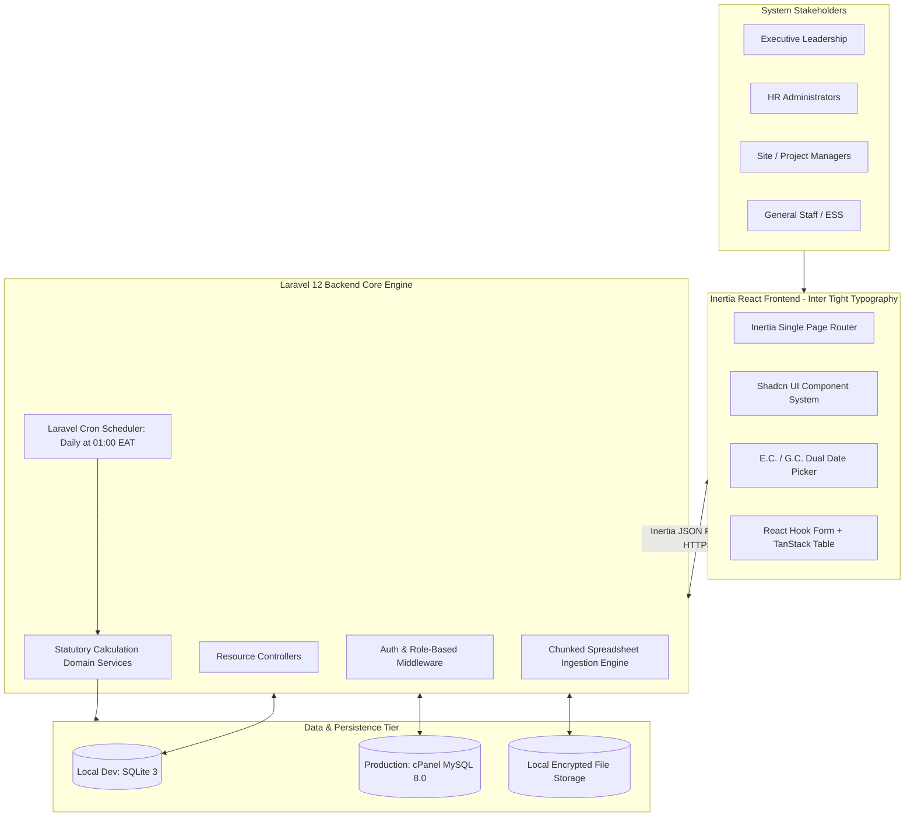
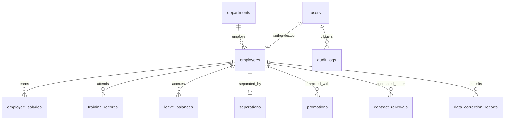

# Elhadar Engineering HRMS - Comprehensive System Plan & Technical Blueprint

**Document Version:** 1.0.0  
**Project:** Human Resource Management System (HRMS)  
**Client:** Elhadar Engineering PLC (Ethiopia)  
**Primary Stack:** Laravel 12 (PHP 8.4) + Inertia.js v2 + React 18 (TypeScript) + Tailwind CSS + Shadcn UI  
**Target Environment:** Local Development & Testing on SQLite; Production Deployment on cPanel Linux (knltraoo / knltrading.com) with MySQL/MariaDB  
**Typography:** Inter Tight (Google Fonts) Exclusively  
**Compliance Standards:** Ethiopian Labour Proclamation No. 1156/2019 & Private Organization Employees' Pension Proclamation No. 1268/2022  

---

## Table of Contents

1. [Executive Summary & System Topology](#1-executive-summary--system-topology)
   - 1.1 Project Mission & Problem Statement
   - 1.2 System Topology & High-Level Architecture
   - 1.3 Key Architectural Principles
2. [Comprehensive Audit & Gap Analysis: DeepSeek PRD vs. Real Elhadar Excel Data](#2-comprehensive-audit--gap-analysis-deepseek-prd-vs-real-elhadar-excel-data)
   - 2.1 Overview of All Sheets in Master Excel File
   - 2.2 Deep Column-by-Column Data Dictionary (All 33 Columns)
   - 2.3 Detailed Mismatch & Gap Analysis Matrix
   - 2.4 Construction-Specific Operating Realities
3. [Ethiopian Statutory & Regulatory Framework](#3-ethiopian-statutory--regulatory-framework)
   - 3.1 Labour Proclamation No. 1156/2019 Specifications
   - 3.2 Pension Proclamation No. 1268/2022 Specifications
   - 3.3 Statutory Mathematical Formulas & Worked Calculations
   - 3.4 Severance Calculation Engine & Edge Cases
4. [Ethiopian Calendar (E.C.) Engine & Architecture](#4-ethiopian-calendar-ec-engine--architecture)
   - 4.1 Ethiopian Calendar Structure & Mathematics
   - 4.2 Bi-Directional Conversion Algorithm (E.C. <-> G.C.)
   - 4.3 UI/UX Dual-Calendar Interaction Design
5. [Architectural Stack & Local SQLite vs. Production cPanel MySQL Strategy](#5-architectural-stack--local-sqlite-vs-production-cpanel-mysql-strategy)
   - 5.1 Monolithic Laravel 12 + Inertia.js v2 Architecture
   - 5.2 Deep Technical Evaluation: SQLite Local vs. cPanel MySQL Production
   - 5.3 Database-Agnostic Migration & Schema Design Strategy
   - 5.4 Seamless Local-to-Production Environment Transition Protocol
6. [Complete Database Schema & Migration Specifications](#6-complete-database-schema--migration-specifications)
   - 6.1 Database Entity Relationship Architecture
   - 6.2 Full Migration Code: `users` & `departments`
   - 6.3 Full Migration Code: `employees`
   - 6.4 Full Migration Code: `employee_salaries`
   - 6.5 Full Migration Code: `training_records`
   - 6.6 Full Migration Code: `leave_balances`
   - 6.7 Full Migration Code: `separations`
   - 6.8 Full Migration Code: `promotions`
   - 6.9 Full Migration Code: `contract_renewals`
   - 6.10 Full Migration Code: `data_correction_reports`
   - 6.11 Full Migration Code: `audit_logs` & `system_settings`
7. [Domain Services & Calculation Engine Implementations](#7-domain-services--calculation-engine-implementations)
   - 7.1 `EthiopianCalendarService`
   - 7.2 `ProbationCalculationService`
   - 7.3 `TenureCalculationService`
   - 7.4 `AnnualLeaveCalculationService`
   - 7.5 `RetirementCalculationService`
   - 7.6 `TurnoverCalculationService`
   - 7.7 `SeveranceCalculationService`
8. [Controller Action & Route Contract (Inertia HTTP Blueprint)](#8-controller-action--route-contract-inertia-http-blueprint)
   - 8.1 Complete Web & Inertia Route Catalog
   - 8.2 Form Request Validations
   - 8.3 Controller Methods & Response Props Shapes
9. [Frontend Design System & Shadcn UI Component Catalog](#9-frontend-design-system--shadcn-ui-component-catalog)
   - 9.1 Shadcn UI Theme Tokens & HSL Variables
   - 9.2 Strict Typography Enforcement (`Inter Tight`)
   - 9.3 Layout System (`AppLayout`, `PortalLayout`, `GuestLayout`)
   - 9.4 Reusable Component Inventory
   - 9.5 Detailed Specifications for All 24 Application Pages
10. [Excel Data Import & Migration Pipeline](#10-excel-data-import--migration-pipeline)
    - 10.1 Multi-Sheet Ingestion Architecture
    - 10.2 Row-by-Row Sanitization & Date Normalization
    - 10.3 Dry-Run Mode & Error Reporting
    - 10.4 Automated Database Seeder via Excel File
11. [cPanel Production Infrastructure & Deployment Manual](#11-cpanel-production-infrastructure--deployment-manual)
    - 11.1 Server Inventory (`knltraoo`, `knltrading.com`, `/home/knltraoo`)
    - 11.2 Subdomain & Document Root Configuration
    - 11.3 PHP 8.4 Runtime, Extensions & Environment Variables
    - 11.4 MySQL Database Creation & User Privileges
    - 11.5 Automated Scheduler (Cron Jobs) Configuration
    - 11.6 SSL, Security Headers & Apache `.htaccess` Hardening
12. [Phased Implementation Roadmap (Phases 1 to 6)](#12-phased-implementation-roadmap-phases-1-to-6)
    - Phase 1: Environment, Database & Security Foundation
    - Phase 2: Excel Ingestion Engine & Master Staff Management
    - Phase 3: Statutory Calculation Engines & Automated Schedulers
    - Phase 4: Executive & Operational Dashboards
    - Phase 5: Training Records, Promotions & ESS Portal
    - Phase 6: cPanel Production Staging, Stress Testing & Handover
13. [Master Implementation & Verification Checklist](#13-master-implementation--verification-checklist)

---

## 1. Executive Summary & System Topology

### 1.1 Project Mission & Problem Statement

Elhadar Engineering PLC is a prominent grade-one general contractor and engineering enterprise operating in Ethiopia. The organization executes complex civil, structural, mechanical, and electrical engineering projects across the country. Its workforce is structurally divided between corporate strategic management at the Addis Ababa Head Office (H.O.) and active project sites deployed in regional zones.

Historically, the administration of personnel records, payroll allowances, probationary status, annual leaves, and employee separations was maintained within a multi-sheet Microsoft Excel workbook (`2Up dateEL-HADAR ENG HR Master List Sep 2025 2.xlsx`). While functional during early operations, this spreadsheet-driven workflow presents acute organizational liabilities:
1. **Compliance Risks under Ethiopian Law:** The statutory limits on probationary periods (Labour Proclamation 1156/2019, Art. 11: 60 working days maximum for non-managerial staff) require active calendar-day tracking excluding rest days and public holidays. Spreadsheet date drift frequently causes employees to involuntarily surpass probation, creating de facto permanent tenure without formal evaluation.
2. **Complex Allowance Structures:** Construction compensation in Ethiopia relies heavily on non-taxable and taxable allowances (Project Allowance, Hardship Allowance, Responsibility Allowance, Site Perdiem, Housing, Transport). Calculating statutory severance and pension contributions requires strict isolation of basic wages from operational allowances.
3. **Calendar Duality:** Dates are maintained in the Ethiopian Calendar (E.C.), with 13 months and a 7-to-8 year offset from the Gregorian Calendar (G.C.). Commercial off-the-shelf HRMS platforms fail when encountering dates formatted as `20/02/2018 E.C.`.
4. **Contract Milestones & Retirement Blindspots:** Project-based contract employees frequently reach contract expiration dates without automated notification. Retiring personnel approaching the statutory retirement age of 60 years under Pension Proclamation 1268/2022 are not identified in advance for POESSA pension filing.

The Elhadar Engineering HRMS automates these statutory calculations, establishes an immutable audit log, provides real-time executive dashboards, enables read-only Employee Self-Service (ESS), and imports historical data directly from the existing Excel master list.

---

### 1.2 System Topology & High-Level Architecture

The system utilizes a monolithic architecture using **Laravel 12 (PHP 8.4)** on the backend and **Inertia.js v2 with React 18 (TypeScript)** on the frontend. The entire user interface is built on **Shadcn UI** primitives and styled strictly using the **Inter Tight** font family.



---

### 1.3 Key Architectural Principles

1. **Monolithic Simplicity via Inertia.js:** Avoids the overhead of maintaining disconnected REST APIs, dual TypeScript DTO definitions, and JWT token refresh mechanisms. Controllers directly supply typed props to React page components.
2. **Strict Dual-Calendar Modeling:** Every date is captured in the Ethiopian Calendar (E.C.) for user display, while stored in standard ISO-8601 Gregorian SQL date columns for indexable, performant interval arithmetic.
3. **Immutability of Audit Trails:** Every modification to employee status, salary components, legal parameters, or department allocations is recorded in an append-only audit table recording user ID, IP address, timestamp, prior state, and new state.
4. **Database Portability:** Database migrations use standard, portable Laravel Blueprint methods without raw SQLite- or MySQL-specific hacks, ensuring identical operation in local development (SQLite) and production (cPanel MySQL).
5. **Radix-Powered Shadcn UI Components:** Guarantees keyboard navigation, screen reader accessibility, responsive mobile sheet drawers for construction site supervisors, and dark/light mode support.

---

## 2. Comprehensive Audit & Gap Analysis: DeepSeek PRD vs. Real Elhadar Excel Data

### 2.1 Overview of All Sheets in Master Excel File

The production Excel workbook `2Up dateEL-HADAR ENG HR Master List Sep 2025 2.xlsx` was inspected. The workbook comprises 9 distinct worksheets:

| Sheet Name | Row Count | Operational Scope & Purpose |
| :--- | :--- | :--- |
| **`All Permanent Employees`** | 1,767 total rows (106 active confirmed staff) | Primary master dataset containing 33 columns. Records full demographic profiles, educational background, workplace assignment, grade/step, granular allowance breakdowns, and pension numbers. |
| **`Project Employees`** | 1,711 total rows | Filtered operational roster tracking staff deployed at active construction sites. Focuses on field allowances, site perdiem, and hazard compensation. |
| **`Head Office Employees`** | 1,699 total rows | Roster of administrative, executive, commercial, and financial staff stationed permanently at the Addis Ababa corporate headquarters. |
| **`Contract emp`** | 1,649 total rows (active project contracts) | Dedicated tracking sheet for fixed-term, project-specific personnel. Introduces the critical `Con.End Day` (Contract End Date) metric. |
| **`PROBATION`** | 6 active candidate rows | Real-time evaluation pipeline tracking newly hired staff, calculating probation deadlines, review dates, and evaluation scores. |
| **`RESIGNED`** | 1,788 total historical rows | Comprehensive historical separations log detailing past resignations, dismissals, lay-offs, and mutual separations with recorded reasons. |
| **`Promotion`** | 8 active promotional records | Historical tracking sheet capturing internal career progressions, detailing prior earnings vs. updated positions, grades, and salary packages. |
| **`File NO`** | 1,731 reference rows | Cross-reference index linking employee alphanumeric codes (`A-001`, `B-010`) to physical HR filing cabinet folders. |
| **`Sheet1`** | 46 scratch rows | Temporary voucher matching and draft staging sheet used during manual payroll preparation. |

---

### 2.2 Deep Column-by-Column Data Dictionary (All 33 Columns)

The master worksheet **`All Permanent Employees`** contains 33 meaningful columns. Each column has been mapped to its target database schema:

```
Index | Header Label in Excel             | Excel Format Examples         | Target DB Table & Column          | Technical Specification & Handling
------+-----------------------------------+-------------------------------+-----------------------------------+------------------------------------------------------------------------
[00]  | NO                                | 1, 2, 3...                    | (UI sequence index / Primary Key) | Row display counter.
[01]  | 000 / File No                     | 'A-001', 'B-010', 'N-007'     | `employees.file_no`               | Alphanumeric string (Letter + 3 digits). Unique physical filing index.
[02]  | Employee Name                     | 'Abay Sewmehon Demena'        | `employees.full_name`             | Full Ethiopian tripartite name (Personal, Father, Grandfather).
[03]  | Education Status                  | '8th Grade', 'BSc in Civil'   | `employees.education_status`      | Educational attainment string. Used for performance scoring.
[04]  | Position                          | 'Metal worker', 'CEO'         | `employees.position`              | Job title and occupational classification.
[05]  | Department                        | 'Engineering Dept', 'Finance' | `departments.name` (FK)           | Foreign key linking to normalized `departments` table.
[06]  | Work Place                        | 'Project', 'H.O'              | `employees.work_place`            | Enum: 'Project', 'Head Office'. Governs allowance eligibility.
[07]  | Sex                               | 'Male', 'Female'              | `employees.gender`                | Enum: 'Male', 'Female'. Used for statutory workforce ratio reports.
[08]  | Date of Emp d/m/y E.C             | '41402' (Serial) / '20/02/18' | `employment_date_ec` & `_date`    | Date of employment in Ethiopian Calendar; converted to Gregorian SQL DATE.
[09]  | Grade                             | 'IV', 'VII', Null             | `employees.grade`                 | Organization salary scale grade identifier.
[10]  | Step                              | '1', '3', Null                | `employees.step`                  | Seniority/increment step within salary grade.
[11]  | Basic Salary                      | 19989.80, 234549.00           | `employee_salaries.basic_salary`  | Decimal(12,2). Statutory base monthly wage before allowances.
[12]  | Responsibility Allowance          | 70364.70, Null                | `employee_salaries.resp_allow`    | Decimal(12,2). Monthly stipend for managerial responsibilities.
[13]  | Project Allowance                 | 3997.96, Null                 | `employee_salaries.proj_allow`    | Decimal(12,2). Monthly site allowance for field deployment.
[14]  | position Allowance                | 2200.00, Null                 | `employee_salaries.pos_allow`     | Decimal(12,2). Fixed role allowance tied to executive hierarchy.
[15]  | Hardship Allowance                | 3500.00, Null                 | `employee_salaries.hard_allow`    | Decimal(12,2). Hazard and remote-location compensation.
[16]  | Transport Allowance               | 2200.00, Null                 | `employee_salaries.trans_allow`   | Decimal(12,2). Commuter allowance (partially tax-exempt).
[17]  | House Allownce                    | 5000.00, Null                 | `employee_salaries.house_allow`   | Decimal(12,2). Residential accommodation stipend.
[18]  | Total Salary                      | 26187.76, 304913.70           | `employee_salaries.total_salary`  | Decimal(12,2). Gross compensation = Basic + All Allowances.
[19]  | Net Salary                        | Decimal / Null                | `employee_salaries.net_salary`    | Decimal(12,2). Net payout after income tax and 7% pension.
[20]  | Employ Status                     | 'Permanent', 'Contract'       | `employees.status`                | Enum: 'Probation', 'Permanent', 'Contract', 'Separated', 'Retired'.
[21]  | Birth Date D/m/y                  | '21/10/1980', '15/04/1972'    | `birth_date_ec` & `birth_date`    | Date of birth. Critical for statutory 60-year retirement engine.
[22]  | Tel No                            | '09-36-75-99-82'              | `employees.phone`                 | Formatted Ethiopian mobile number (+251 9... / +251 7...).
[23]  | Marital Status                    | 'Single', 'Married'           | `employees.marital_status`        | String: 'Single', 'Married', 'Divorced', 'Widowed'.
[24]  | Region                            | 'Amara', 'Oromia', 'Addis'    | `employees.region`                 | Regional State of Ethiopia.
[25]  | Citiy                             | 'Semen Wello', 'Addis Ababa'  | `employees.city`                   | Administrative city or zone.
[26]  | K/ Ketema                         | 'lalibela', 'Bole', 'Yeka'    | `employees.sub_city`               | Kifle Ketema (Sub-city) or municipal district.
[27]  | Wereda                            | '02', 'Woreda 04', Null       | `employees.woreda`                 | Local district/ward division.
[28]  | H/No                              | 'New', '142', 'B12-4'         | `employees.house_no`               | Kebele residential house number.
[29]  | Remark/ End date of Probation     | 'Pass', '29/04/2018'          | `probation_status` & `_end_date`   | Evaluated status of statutory probationary period.
[30]  | Annual Leave                      | 16.0, 18.0, 22.0              | `leave_balances.remaining_days`    | Accrued unused annual leave balance.
[31]  | Social Security Number            | 'POESSA-98124', Null          | `employees.social_security_no`     | National POESSA pension account number.
[32]  | Emergency. Contact                | '09-43-04-06-29'              | `emergency_contact_phone`          | Primary emergency contact telephone number.
```

---

### 2.3 Detailed Mismatch & Gap Analysis Matrix

The table below contrasts DeepSeek's initial PRD assumptions against the operational reality discovered in Elhadar Engineering's workbook:

| Analysis Category | DeepSeek PRD Draft | Elhadar Reality in Excel File | Technical Resolution in HRMS Blueprint |
| :--- | :--- | :--- | :--- |
| **System Architecture** | Decoupled PERN (Express.js, Node.js, React, PostgreSQL) | Unified **Laravel 12 + Inertia.js v2 + React 18 + TS** | Leverages Laravel's native queue workers, scheduled tasks, and session authentication without duplicate REST endpoints. |
| **Calendar Standard** | Standard Gregorian `DATE` SQL columns | **Ethiopian Calendar (E.C.)** throughout (`d/m/y E.C`) | Implementation of bi-directional `EthiopianCalendarService` supporting 13 Ethiopian months and dual UI date pickers. |
| **Employee Identifier** | Single generic `employee_code` | Two separate keys: `File No` (`A-001`) and `Empl ID No` | Database maintains `file_no` as unique primary business key matching physical filing cabinets, alongside optional `employee_id_no`. |
| **Salary Architecture** | Flat `base_salary: NUMERIC(12,2)` | **8 distinct allowance columns** plus Gross/Net values | Dedicated `employee_salaries` table storing basic wage, responsibility, project, position, hardship, transport, and housing allowances. |
| **Workplace Partitioning** | Completely overlooked | Strict operational division: `Project` vs `Head Office (H.O)` | Core `work_place` attribute driving project allowance eligibility, hardship stipends, and executive dashboard segmentations. |
| **Contract Management** | Treated uniformly as permanent staff | Dedicated **`Contract emp`** sheet with **`Con.End Day`** | Dedicated contract tracking module with automated 30-day and 15-day expiration countdown alerts. |
| **Probation Monitoring** | Basic 60-day countdown timer | Dedicated **`PROBATION`** board tracking deadlines and scores | Multi-state probation pipeline (`Pending`, `Under Review`, `Permanent Confirmed`, `Terminated`) with HR evaluation forms. |
| **Demographics & Address** | Simple phone/email strings | Granular Ethiopian hierarchy: Region, City, Sub-City, Woreda, H/No | Structured address schema compliant with Ethiopian Ministry of Labor (MOLSA) and POESSA reporting standards. |
| **Career & Promotions** | Only external training courses | Dedicated **`Promotion`** log capturing historical salary hikes | Normalized `promotions` ledger tracking salary and title progressions over time. |

---

### 2.4 Construction-Specific Operating Realities

1. **Dual Filing Infrastructure:** In construction operations, site managers frequently reference physical documentation binders organized by letter codes (e.g., Folder `A` for names beginning with Abebe/Alazar, Folder `M` for Mesfin). The system must expose the `File No` across all search filters, badge headers, and data grids.
2. **Project-Based Demobilization:** Construction projects have finite lifecycles. Contract workers hired for the "Lalibela Water Works Project" have fixed contract termination dates (`Con.End Day`). The HRMS must warn project coordinators 30 days prior to contract expiration to initiate renewals or demobilization procedures.
3. **Hardship and Site Perdiem Rules:** Construction personnel stationed in harsh, remote topographies qualify for statutory hardship allowances. The system must automatically validate whether an employee assigned to `work_place = 'Project'` has the mandatory project and hardship allowances populated.

---

## 3. Ethiopian Statutory & Regulatory Framework

The automated calculation engine is governed by two federal proclamations:
- **Labour Proclamation No. 1156/2019**
- **Private Organization Employees' Pension Proclamation No. 1268/2022**

### 3.1 Labour Proclamation No. 1156/2019 Specifications

#### Article 11: Probationary Period
- **Statutory Duration:** Maximum of **60 working days** from the commencement of employment.
- **Working Days Definition:** Sundays and statutory public holidays are excluded from the countdown. For employees working a standard 6-day week (Monday through Saturday, 48 hours under Article 61), Saturdays are counted; Sundays are excluded.
- **Termination Right:** During probation, either party may terminate the employment contract without notice, severance, or compensation.
- **Managerial Exemption (Article 4):** Managerial personnel are legally excluded from the scope of Proclamation 1156/2019. In accordance with Elhadar Engineering corporate policy, managerial employees are assigned a **90 calendar-day probation period**.

#### Article 77: Annual Leave Entitlements
- **Base Entitlement:** A worker is entitled to an uninterrupted minimum of **16 working days** of paid annual leave for the first full year of service.
- **Service Increment:** For every additional **two full years of continuous service**, the annual leave entitlement increases by **one working day**.
- **Accrual Continuity:** Annual leave cannot be waived for financial compensation except upon termination of employment.

#### Articles 39, 40 & 41: Severance Pay & Compensation
- **Eligibility:** Employees with continuous service whose contracts are terminated under eligible statutory conditions (layoff due to workforce reduction, bankruptcy, termination without cause, or constructive dismissal).
- **First Year Rate:** Equal to **30 days (1 month) of average basic wage** for the first full year of continuous service.
- **Subsequent Years Rate:** For service beyond the first year, an additional **1/3 of the monthly basic wage** for each completed year.
- **Pro-ration for Incomplete Years:** Service of less than a full year is calculated proportionally.
- **Statutory Maximum Cap:** The total severance payout under Article 40(1) cannot exceed **12 months of the employee's basic wage**.

#### Article 61: Normal Hours of Work
- Normal working hours cannot exceed **8 hours per day** or **48 hours per week**.

---

### 3.2 Pension Proclamation No. 1268/2022 Specifications

#### Article 19: Mandatory Retirement Age
- The statutory retirement age for private sector employees is **60 years** for both male and female staff.
- **Advance Notification Mandate:** To ensure timely submission of pension documentation to POESSA, the system must trigger an automated warning to HR Administrators **90 calendar days prior** to the employee reaching their 60th birthday.

---

### 3.3 Statutory Mathematical Formulas & Worked Calculations

```
====================================================================================================
1. PROBATION PERIOD FORMULAS
====================================================================================================
Non-Managerial Staff (Working Days Engine):
    Target End Date = EmploymentDate + (60 Working Days excluding Sundays and Federal Holidays)
    Days Remaining = CountWorkingDays(CurrentDate -> TargetEndDate)

Managerial Staff (Calendar Days Engine):
    Target End Date = EmploymentDate + 90 Calendar Days
    Days Remaining = Max(0, TargetEndDate - CurrentDate)

====================================================================================================
2. CONTINUOUS SERVICE TENURE FORMULA
====================================================================================================
Tenure Days:
    TenureDays = CurrentDate - EmploymentDate (excluding recorded unpaid leaves)
Formatted Tenure:
    Years = Floor(TenureDays / 365.25)
    RemainingDays = TenureDays - (Years * 365.25)
    Months = Floor(RemainingDays / 30.4375)
    Days = Round(RemainingDays - (Months * 30.4375))

====================================================================================================
3. STATUTORY ANNUAL LEAVE ACCRUAL FORMULA (Art. 77)
====================================================================================================
Completed Service Years (Y) = Floor((CurrentDate - EmploymentDate) / 365.25)
Statutory Entitlement = 16 + Floor(Max(0, Y - 1) / 2)
Current Balance = (CarriedOverLeave + CurrentYearEntitlement) - ApprovedLeaveTaken

====================================================================================================
4. SEVERANCE PAY FORMULA (Arts. 39-41)
====================================================================================================
Daily Wage (DW) = BasicSalary / 30.0
Year 1 Entitlement = 30 * DW = BasicSalary
Years Beyond First (Y_sub) = Max(0, Y - 1) + (RemainingMonths / 12) + (RemainingDays / 365)
Subsequent Entitlement = Y_sub * (BasicSalary / 3.0)
Total Raw Severance = Year 1 Entitlement + Subsequent Entitlement
Final Severance Payout = Min(Total Raw Severance, 12 * BasicSalary)

====================================================================================================
5. HR TURNOVER RATE FORMULA
====================================================================================================
Average Headcount = (ActiveStaff_StartOfPeriod + ActiveStaff_EndOfPeriod) / 2.0
Turnover Rate (%) = (TotalSeparationsInPeriod / AverageHeadcount) * 100.0
```

---

### 3.4 Severance Calculation Engine & Edge Cases

#### Case 1: Site Engineer with 5 Years and 6 Months Service (Basic Salary = 24,000 ETB)
- **Year 1:** 24,000.00 ETB (1 month basic wage)
- **Remaining Service:** 4.5 years
- **Subsequent Entitlement:** 4.5 * (24,000 / 3) = 4.5 * 8,000 = 36,000.00 ETB
- **Total Severance:** 24,000 + 36,000 = **60,000.00 ETB**
- **Statutory Cap Verification:** 12 * 24,000 = 288,000 ETB. Payout is well within the cap.

#### Case 2: Executive with 32 Years Service (Basic Salary = 45,000 ETB)
- **Year 1:** 45,000.00 ETB
- **Remaining Service:** 31 years
- **Subsequent Entitlement:** 31 * (45,000 / 3) = 31 * 15,000 = 465,000.00 ETB
- **Total Raw Severance:** 45,000 + 465,000 = 510,000.00 ETB
- **Statutory Cap Verification:** Maximum legal cap = 12 * 45,000 = **540,000.00 ETB**. Since raw severance (510,000 ETB) is below 540,000 ETB, the employee receives the full 510,000.00 ETB.

---

## 4. Ethiopian Calendar (E.C.) Engine & Architecture

### 4.1 Ethiopian Calendar Structure & Mathematics

The Ethiopian calendar is a solar calendar closely related to the Coptic and Julian calendars:
1. **Year Distribution:** A year contains **12 identical months of 30 days each**, followed by an intercalary 13th month called **Pagume** (*ጳጉሜ*).
2. **Pagume Duration:** In standard years, Pagume contains **5 days**. In an Ethiopian leap year, Pagume contains **6 days**.
3. **Leap Year Rule:** An Ethiopian leap year occurs unconditionally **every 4 years without century exceptions**. An Ethiopian year `Y_ec` is a leap year if:
   $$	ext{IsLeap}(Y_{ec}) \iff (Y_{ec} \pmod 4) = 3$$
4. **New Year Transition:** Ethiopian New Year (*Enkutatash* / *እንቁጣጣሽ*) falls on **September 11 Gregorian** (or September 12 in the year preceding a Gregorian leap year).
5. **Year Offset:** The Ethiopian calendar lags the Gregorian calendar by **7 years and 8 months** (from January 1 to September 10) and **7 years** (from September 11 to December 31).

#### Ethiopian Months Roster:
1. Meskerem (*መስከረም*) - 30 days (Starts Sept 11/12 G.C.)
2. Tikimt (*ጥቅምት*) - 30 days (Starts Oct 11/12 G.C.)
3. Hidar (*ኅዳር*) - 30 days (Starts Nov 10/11 G.C.)
4. Tahsas (*ታኅሣሥ*) - 30 days (Starts Dec 10/11 G.C.)
5. Tir (*ጥር*) - 30 days (Starts Jan 09/10 G.C.)
6. Yakatit (*የካቲት*) - 30 days (Starts Feb 08/09 G.C.)
7. Magabit (*መጋቢት*) - 30 days (Starts Mar 10 G.C.)
8. Miyazya (*ሚያዝያ*) - 30 days (Starts Apr 09 G.C.)
9. Ginbot (*ግንቦት*) - 30 days (Starts May 09 G.C.)
10. Sene (*ሰኔ*) - 30 days (Starts Jun 08 G.C.)
11. Hamle (*ሐምሌ*) - 30 days (Starts Jul 08 G.C.)
12. Nehase (*ነሐሴ*) - 30 days (Starts Aug 07 G.C.)
13. Pagume (*ጳጉሜ*) - 5 or 6 days (Starts Sep 06 G.C.)

---

### 4.2 Bi-Directional Conversion Algorithm (E.C. <-> G.C.)

Conversion utilizes a Julian Day Number (JDN) pivot to guarantee 100% mathematical accuracy across all centuries.

```php
<?php

namespace App\Services;

use Carbon\Carbon;
use InvalidArgumentException;

class EthiopianCalendarService
{
    private const ETHIOPIAN_EPOCH_JDN = 1723856; // JDN of Meskerem 1, 1 E.C. (August 29, 8 CE Julian)

    /**
     * Convert Ethiopian Date to Gregorian Carbon instance.
     */
    public static function toGregorian(int $year, int $month, int $day): Carbon
    {
        if ($month < 1 || $month > 13) {
            throw new InvalidArgumentException("Ethiopian month must be between 1 and 13.");
        }
        $isLeap = ($year % 4 === 3);
        $maxPagume = $isLeap ? 6 : 5;
        if ($month === 13 && ($day < 1 || $day > $maxPagume)) {
            throw new InvalidArgumentException("Pagume has {$maxPagume} days in year {$year}.");
        }
        if ($month < 13 && ($day < 1 || $day > 30)) {
            throw new InvalidArgumentException("Ethiopian months 1-12 have exactly 30 days.");
        }

        $jdn = (self::ETHIOPIAN_EPOCH_JDN + 365 * ($year - 1) + intdiv($year, 4) + 30 * ($month - 1) + $day - 1);
        return self::jdnToGregorian($jdn);
    }

    /**
     * Convert Gregorian Carbon instance to Ethiopian Date array [year, month, day].
     *
     * @return array{year: int, month: int, day: int, formatted: string}
     */
    public static function toEthiopian(Carbon $date): array
    {
        $jdn = self::gregorianToJdn($date->year, $date->month, $date->day);
        $r = ($jdn - self::ETHIOPIAN_EPOCH_JDN) % 1461;
        $n = ($r % 365) + 365 * intdiv($r, 1460);

        $year = 4 * intdiv($jdn - self::ETHIOPIAN_EPOCH_JDN, 1461) + intdiv($r, 365) - intdiv($r, 1460);
        $month = intdiv($n, 30) + 1;
        $day = ($n % 30) + 1;

        return [
            'year' => $year,
            'month' => $month,
            'day' => $day,
            'formatted' => sprintf('%02d/%02d/%04d', $day, $month, $year),
        ];
    }

    private static function gregorianToJdn(int $year, int $month, int $day): int
    {
        $a = intdiv(14 - $month, 12);
        $y = $year + 4800 - $a;
        $m = $month + 12 * $a - 3;
        return $day + intdiv(153 * $m + 2, 5) + 365 * $y + intdiv($y, 4) - intdiv($y, 100) + intdiv($y, 400) - 32045;
    }

    private static function jdnToGregorian(int $jdn): Carbon
    {
        $l = $jdn + 68569;
        $n = intdiv(4 * $l, 146097);
        $l = $l - intdiv(146097 * $n + 3, 4);
        $i = intdiv(4000 * ($l + 1), 1461001);
        $l = $l - intdiv(1461 * $i, 4) + 31;
        $j = intdiv(80 * $l, 2447);
        $day = $l - intdiv(2447 * $j, 80);
        $l = intdiv($j, 11);
        $month = $j + 2 - 12 * $l;
        $year = 100 * ($n - 49) + $i + $l;

        return Carbon::createFromDate($year, $month, $day);
    }
}
```

---

### 4.3 UI/UX Dual-Calendar Interaction Design

To ensure optimal usability for HR staff:
1. **Interactive Dual-Mode Date Picker (`EthiopianDatePicker.tsx`):**
   - Renders month views labeled with Ethiopian month names (*Meskerem*, *Tikimt*, etc.).
   - Includes a floating toggle: `[Switch to Gregorian (G.C.) | Switch to Ethiopian (E.C.)]`.
   - Selecting a date updates both values in state simultaneously (e.g., Selecting `20/02/2018 E.C.` automatically computes and previews `October 31, 2025 G.C.`).
2. **Dual-Badge Table Formatting:**
   - In all employee lists, dates are displayed with the Ethiopian date prominent, accompanied by a subtle muted tooltip showing the Gregorian equivalent:
     ```tsx
     <div className="flex flex-col">
       <span className="font-medium text-foreground">{employee.employment_date_ec}</span>
       <span className="text-xs text-muted-foreground">({employee.employment_date})</span>
     </div>
     ```

---

## 5. Architectural Stack & Local SQLite vs. Production cPanel MySQL Strategy

### 5.1 Monolithic Laravel 12 + Inertia.js v2 Architecture

The Elhadar Engineering HRMS is architected as a modern monolithic web application using **Laravel 12 (PHP 8.4)** and **Inertia.js v2** driving a **React 18 (TypeScript)** single-page application frontend. 

```
+----------------------------------------------------------------------------------------------------+
|                                     INERTIA.JS MONOLITH ARCHITECTURE                               |
+----------------------------------------------------------------------------------------------------+
|  BROWSER CLIENT (React 18 + TS + Shadcn UI + Inter Tight)                                          |
|    - Single-page application lifecycle with zero full page reloads                                 |
|    - Client-side routing via `@inertiajs/react`                                                    |
|    - Server-side data contracts passed directly as props via controllers                           |
|    - Instant UI validation and form state handling                                                 |
+--------------------------------------------------+-------------------------------------------------+
                                                   | HTTP / Inertia Protocol JSON Responses
+--------------------------------------------------v-------------------------------------------------+
|  LARAVEL 12 APPLICATION CORE (PHP 8.4)                                                             |
|    - Route handlers return `Inertia::render('PageName', [ 'data' => $data ])`                       |
|    - Built-in session authentication (Laravel Sanctum/Breeze cookies, CSRF protection)              |
|    - Statutory business logic encapsulated in dedicated Domain Services                            |
|    - Native scheduled commands (`php artisan schedule:run`) for daily midnight calculations        |
|    - Eloquent ORM abstracting database persistence                                                 |
+--------------------------------------------------+-------------------------------------------------+
                                                   | Universal Eloquent Database Layer
+--------------------------------------------------v-------------------------------------------------+
|  DATABASE TIERS                                                                                    |
|    - LOCAL DEVELOPMENT: SQLite 3 (`database/database.sqlite`)                                      |
|    - PRODUCTION (cPanel): MySQL 8.0 / MariaDB 10.6 (`knltraoo_hrms`)                               |
+----------------------------------------------------------------------------------------------------+
```

#### Why Inertia.js Beats a Decoupled REST/JWT Architecture:
1. **Zero Duplicate API Layer:** There is no need to create separate API controllers, define repetitive OpenAPI specifications, or build client-side fetchers with axios token interceptors.
2. **Built-in Security:** Inherits Laravel's battle-tested session-based authentication and CSRF token verification. No JWT token storage in `localStorage` (which is vulnerable to XSS attacks).
3. **Type Safety:** Server models and calculation outputs map directly to shared TypeScript interfaces (`resources/js/types/hrms.d.ts`), preventing client-server contract mismatches.
4. **Fast Prototyping:** Allows rapid UI development while maintaining the interactive feel of a single-page React app.

---

### 5.2 Deep Technical Evaluation: SQLite Local vs. cPanel MySQL Production

The user asked: *"we have to check everything here in sqlite (tell me your opinion about this)"*.

Here is the authoritative technical analysis regarding using **SQLite locally** and deploying to **MySQL on cPanel (`knltraoo` / `knltrading.com`)**:

```
+---------------------+------------------------------------------------+------------------------------------------------+
| Technical Metric    | Local Development: SQLite 3                    | Production cPanel: MySQL 8.0 / MariaDB         |
+---------------------+------------------------------------------------+------------------------------------------------+
| Performance Profile | Exceptionally fast for single-user dev;        | High concurrency; row-level locking handles    |
|                     | zero network latency; runs entirely in-memory  | multi-user HR updates and background imports   |
|                     | or on fast local NVMe SSD.                     | simultaneously.                                |
+---------------------+------------------------------------------------+------------------------------------------------+
| Write Concurrency   | File-level write locking. Simultaneous writes  | Row-level locking (InnoDB engine). Multiple    |
|                     | (e.g. background scheduler + Excel import +    | users can edit staff records concurrently      |
|                     | active user edit) can produce `database        | without table or file contention.              |
|                     | locked` exceptions (`SQLITE_BUSY`).            |                                                |
+---------------------+------------------------------------------------+------------------------------------------------+
| Setup & Portability | Zero server configuration. The database is a   | Requires database creation, user privileges    |
|                     | single file (`database/database.sqlite`). Easy | assignment, and `.env` credentials in cPanel.  |
|                     | to commit seeds, clone, and backup.            | Standard cPanel phpMyAdmin access.             |
+---------------------+------------------------------------------------+------------------------------------------------+
| cPanel File System  | Shared hosting file systems frequently have    | MySQL runs as a dedicated daemon process       |
| Compatibility       | latency and locking bugs with SQLite file      | optimized by the cPanel host with automated    |
|                     | locks across web server worker pools.          | backup dumps and crash recovery.               |
+---------------------+------------------------------------------------+------------------------------------------------+
| Testing Speed       | Automated test suite (`php artisan test`) runs | Slower for rapid local test loops due to       |
|                     | in seconds using SQLite in-memory databases.   | TCP socket connection and transaction tear-   |
|                     |                                                | down overhead.                                 |
+---------------------+------------------------------------------------+------------------------------------------------+
```

#### Final Verdict & Recommendation:
> **Using SQLite locally is an outstanding choice.** It gives us lightning-fast iteration, immediate unit test runs, zero setup friction, and zero background services to configure on your development machine.
>
> **However, for production on your cPanel server (`knltraoo`), MySQL/MariaDB is strongly recommended.** 
> In production, when multiple HR officers log in, employees access the ESS portal, the background scheduler runs nightly probation updates, and large Excel rosters are imported, SQLite's single-file write lock (`SQLITE_BUSY: database is locked`) can cause requests to fail. 
> 
> Because Laravel's Eloquent ORM completely abstracts the database engine, **you get the best of both worlds**:
> - We develop, build, test, and verify 100% of the HRMS locally using **SQLite**.
> - When deploying to your cPanel hosting account, we simply update the `.env` database configuration to point to **cPanel's native MySQL** database (`DB_CONNECTION=mysql`). 
> - **Zero code changes** are required in your models, controllers, or frontend!

---

### 5.3 Database-Agnostic Migration & Schema Design Strategy

To ensure seamless portability between local SQLite and production MySQL, all database migrations must adhere to strict portability standards:
1. **No Database-Specific Column Types:** Use standard Blueprint methods: `decimal('amount', 12, 2)`, `string('name', 255)`, `date('recorded_at')`, `boolean('is_active')`, `json('metadata')`.
2. **Explicit Index Naming:** Always provide explicit names for composite unique keys and indexes to prevent database engine naming conflicts.
3. **Foreign Key Integrity:** Define cascade behaviors cleanly: `cascadeOnDelete()`, `nullOnDelete()`, or `restrictOnDelete()`. SQLite supports foreign keys when enabled (Laravel handles `PRAGMA foreign_keys = ON;` automatically).
4. **No Raw SQL Triggers:** Avoid engine-specific triggers or stored procedures; handle audit trails and computed date updates within Laravel Eloquent Model Observers and Domain Services.

---

### 5.4 Seamless Local-to-Production Environment Transition Protocol

Switching the application from local SQLite to cPanel MySQL requires only updating `.env`:

#### Local Development Configuration (`.env`):
```ini
APP_NAME="Elhadar Engineering HRMS"
APP_ENV=local
APP_KEY=base64:GeneratedKeyHere...
APP_DEBUG=true
APP_URL=http://localhost:8000

DB_CONNECTION=sqlite
# DB_DATABASE is automatically set to database/database.sqlite
```

#### Production cPanel Configuration (`.env`):
```ini
APP_NAME="Elhadar Engineering HRMS"
APP_ENV=production
APP_KEY=base64:GeneratedKeyHere...
APP_DEBUG=false
APP_URL=https://hrms.knltrading.com

DB_CONNECTION=mysql
DB_HOST=127.0.0.1
DB_PORT=3306
DB_DATABASE=knltraoo_hrms
DB_USERNAME=knltraoo_hrmsuser
DB_PASSWORD=SecureProductionPassword123!
```

---

## 6. Complete Database Schema & Migration Specifications

Below is the complete database schema implemented as standard Laravel Blueprint migrations.



---

### 6.2 Full Migration Code: `users` & `departments`

```php
<?php

use Illuminate\Database\Migrations\Migration;
use Illuminate\Database\Schema\Blueprint;
use Illuminate\Support\Facades\Schema;

return new class extends Migration
{
    public function up(): void
    {
        Schema::create('departments', function (Blueprint $table) {
            $table->id();
            $table->string('name', 100)->unique();
            $table->string('code', 20)->nullable()->unique();
            $table->string('description', 255)->nullable();
            $table->boolean('is_active')->default(true);
            $table->timestamps();
        });

        Schema::create('users', function (Blueprint $table) {
            $table->id();
            $table->string('name');
            $table->string('email')->unique();
            $table->timestamp('email_verified_at')->nullable();
            $table->string('password');
            $table->enum('role', ['SysAdmin', 'HRAdmin', 'Manager', 'Employee'])->default('Employee');
            $table->boolean('is_active')->default(true);
            $table->rememberToken();
            $table->timestamps();
        });
    }

    public function down(): void
    {
        Schema::dropIfExists('users');
        Schema::dropIfExists('departments');
    }
};
```

---

### 6.3 Full Migration Code: `employees`

```php
<?php

use Illuminate\Database\Migrations\Migration;
use Illuminate\Database\Schema\Blueprint;
use Illuminate\Support\Facades\Schema;

return new class extends Migration
{
    public function up(): void
    {
        Schema::create('employees', function (Blueprint $table) {
            $table->id();
            $table->foreignId('user_id')->nullable()->unique()->constrained('users')->nullOnDelete();
            $table->string('file_no', 20)->unique()->comment('Alphanumeric physical file code e.g. A-001');
            $table->string('employee_id_no', 50)->nullable()->unique()->comment('Company corporate employee ID');
            $table->string('full_name', 255);
            $table->enum('gender', ['Male', 'Female']);
            $table->string('education_status', 150)->nullable();
            $table->foreignId('department_id')->constrained('departments')->restrictOnDelete();
            $table->string('position', 150);
            $table->enum('work_place', ['Project', 'Head Office'])->default('Head Office');
            $table->enum('employment_type', ['Non-Managerial', 'Managerial'])->default('Non-Managerial');
            $table->enum('contract_type', ['Permanent', 'Contract', 'Daily'])->default('Permanent');
            
            // Ethiopian Calendar & Gregorian Dates
            $table->string('employment_date_ec', 20);
            $table->date('employment_date')->index();
            $table->string('birth_date_ec', 20)->nullable();
            $table->date('birth_date')->nullable()->index();
            
            // Statutory Milestones
            $table->date('probation_end_date')->nullable()->index();
            $table->enum('probation_status', ['Pending', 'Passed', 'Failed', 'Extended'])->default('Pending');
            $table->date('permanent_status_date')->nullable();
            $table->date('contract_end_date')->nullable()->index()->comment('Applicable for Contract emp sheet');
            $table->date('retirement_date')->nullable()->index();
            $table->enum('status', ['Probation', 'Permanent', 'Contract', 'Separated', 'Retired'])->default('Probation')->index();
            
            // Grading & Social Security
            $table->string('grade', 20)->nullable();
            $table->string('step', 20)->nullable();
            $table->string('social_security_no', 50)->nullable()->index();
            $table->string('marital_status', 30)->nullable();
            
            // Demographics & Address
            $table->string('phone', 30)->nullable();
            $table->string('email', 100)->nullable();
            $table->string('region', 100)->nullable();
            $table->string('city', 100)->nullable();
            $table->string('sub_city', 100)->nullable()->comment('K/Ketema');
            $table->string('woreda', 50)->nullable();
            $table->string('house_no', 50)->nullable();
            
            // Emergency Contact
            $table->string('emergency_contact_name', 150)->nullable();
            $table->string('emergency_contact_phone', 50)->nullable();
            
            $table->softDeletes();
            $table->timestamps();
        });
    }

    public function down(): void
    {
        Schema::dropIfExists('employees');
    }
};
```

---

### 6.4 Full Migration Code: `employee_salaries`

```php
<?php

use Illuminate\Database\Migrations\Migration;
use Illuminate\Database\Schema\Blueprint;
use Illuminate\Support\Facades\Schema;

return new class extends Migration
{
    public function up(): void
    {
        Schema::create('employee_salaries', function (Blueprint $table) {
            $table->id();
            $table->foreignId('employee_id')->constrained('employees')->cascadeOnDelete();
            
            // Salary Structure Breakdown
            $table->decimal('basic_salary', 12, 2)->default(0.00);
            $table->decimal('responsibility_allowance', 12, 2)->default(0.00);
            $table->decimal('project_allowance', 12, 2)->default(0.00);
            $table->decimal('position_allowance', 12, 2)->default(0.00);
            $table->decimal('hardship_allowance', 12, 2)->default(0.00);
            $table->decimal('transport_allowance', 12, 2)->default(0.00);
            $table->decimal('house_allowance', 12, 2)->default(0.00);
            $table->decimal('ot_compensation', 12, 2)->default(0.00);
            $table->decimal('perdiem', 12, 2)->default(0.00);
            
            // Calculated Totals
            $table->decimal('total_salary', 12, 2)->default(0.00)->comment('Gross compensation sum');
            $table->decimal('net_salary', 12, 2)->nullable();
            
            $table->date('effective_date')->index();
            $table->boolean('is_current')->default(true)->index();
            $table->string('remarks', 255)->nullable();
            $table->timestamps();
        });
    }

    public function down(): void
    {
        Schema::dropIfExists('employee_salaries');
    }
};
```

---

### 6.5 Full Migration Code: `training_records`

```php
<?php

use Illuminate\Database\Migrations\Migration;
use Illuminate\Database\Schema\Blueprint;
use Illuminate\Support\Facades\Schema;

return new class extends Migration
{
    public function up(): void
    {
        Schema::create('training_records', function (Blueprint $table) {
            $table->id();
            $table->foreignId('employee_id')->constrained('employees')->cascadeOnDelete();
            $table->string('training_name', 255);
            $table->string('institution', 255)->nullable();
            $table->enum('provider_type', ['Internal', 'External'])->default('External');
            $table->date('start_date')->nullable();
            $table->date('end_date')->nullable();
            $table->string('certificate_number', 100)->nullable();
            $table->string('certificate_path', 255)->nullable()->comment('Relative storage path to scanned PDF/JPG');
            $table->unsignedTinyInteger('performance_impact_score')->default(3)->comment('Scale 1-5');
            $table->text('notes')->nullable();
            $table->timestamps();
        });
    }

    public function down(): void
    {
        Schema::dropIfExists('training_records');
    }
};
```

---

### 6.6 Full Migration Code: `leave_balances`

```php
<?php

use Illuminate\Database\Migrations\Migration;
use Illuminate\Database\Schema\Blueprint;
use Illuminate\Support\Facades\Schema;

return new class extends Migration
{
    public function up(): void
    {
        Schema::create('leave_balances', function (Blueprint $table) {
            $table->id();
            $table->foreignId('employee_id')->constrained('employees')->cascadeOnDelete();
            $table->unsignedSmallInteger('leave_year')->index()->comment('e.g. 2025 or 2017 E.C.');
            $table->decimal('entitled_days', 5, 1)->default(16.0)->comment('16 base + 1 per 2 service years');
            $table->decimal('carried_over_days', 5, 1)->default(0.0);
            $table->decimal('taken_days', 5, 1)->default(0.0);
            $table->decimal('remaining_days', 5, 1)->default(16.0);
            $table->timestamps();

            $table->unique(['employee_id', 'leave_year'], 'emp_leave_year_unique');
        });
    }

    public function down(): void
    {
        Schema::dropIfExists('leave_balances');
    }
};
```

---

### 6.7 Full Migration Code: `separations`

```php
<?php

use Illuminate\Database\Migrations\Migration;
use Illuminate\Database\Schema\Blueprint;
use Illuminate\Support\Facades\Schema;

return new class extends Migration
{
    public function up(): void
    {
        Schema::create('separations', function (Blueprint $table) {
            $table->id();
            $table->foreignId('employee_id')->unique()->constrained('employees')->restrictOnDelete();
            $table->enum('separation_type', [
                'Resignation',
                'Termination_With_Cause',
                'Termination_Without_Cause',
                'Layoff',
                'Retirement',
                'Probation_Failed',
                'Contract_Expired'
            ])->index();
            $table->date('effective_date')->index();
            $table->text('reason')->nullable();
            $table->decimal('basic_salary_at_separation', 12, 2);
            $table->decimal('completed_years_service', 5, 2);
            $table->decimal('severance_amount', 12, 2)->default(0.00)->comment('Calculated per Proclamation 1156/2019');
            $table->boolean('severance_paid')->default(false);
            $table->timestamps();
        });
    }

    public function down(): void
    {
        Schema::dropIfExists('separations');
    }
};
```

---

### 6.8 Full Migration Code: `promotions`

```php
<?php

use Illuminate\Database\Migrations\Migration;
use Illuminate\Database\Schema\Blueprint;
use Illuminate\Support\Facades\Schema;

return new class extends Migration
{
    public function up(): void
    {
        Schema::create('promotions', function (Blueprint $table) {
            $table->id();
            $table->foreignId('employee_id')->constrained('employees')->cascadeOnDelete();
            $table->string('promotion_date_ec', 20)->comment('Ethiopian Calendar date of promotion');
            $table->date('promotion_date')->index();
            
            // Prior Position & Compensation
            $table->string('previous_position', 150);
            $table->string('previous_grade', 20)->nullable();
            $table->decimal('previous_basic_salary', 12, 2);
            $table->decimal('previous_total_salary', 12, 2);
            
            // New Position & Compensation
            $table->string('new_position', 150);
            $table->string('new_grade', 20)->nullable();
            $table->decimal('new_basic_salary', 12, 2);
            $table->decimal('new_total_salary', 12, 2);
            
            $table->text('remarks')->nullable();
            $table->timestamps();
        });
    }

    public function down(): void
    {
        Schema::dropIfExists('promotions');
    }
};
```

---

### 6.9 Full Migration Code: `contract_renewals`

```php
<?php

use Illuminate\Database\Migrations\Migration;
use Illuminate\Database\Schema\Blueprint;
use Illuminate\Support\Facades\Schema;

return new class extends Migration
{
    public function up(): void
    {
        Schema::create('contract_renewals', function (Blueprint $table) {
            $table->id();
            $table->foreignId('employee_id')->constrained('employees')->cascadeOnDelete();
            $table->date('start_date');
            $table->date('end_date')->index();
            $table->string('project_name', 150)->nullable();
            $table->decimal('agreed_salary', 12, 2);
            $table->enum('status', ['Active', 'Expired', 'Renewed', 'Terminated'])->default('Active');
            $table->text('terms_summary')->nullable();
            $table->timestamps();
        });
    }

    public function down(): void
    {
        Schema::dropIfExists('contract_renewals');
    }
};
```

---

### 6.10 Full Migration Code: `data_correction_reports`

```php
<?php

use Illuminate\Database\Migrations\Migration;
use Illuminate\Database\Schema\Blueprint;
use Illuminate\Support\Facades\Schema;

return new class extends Migration
{
    public function up(): void
    {
        Schema::create('data_correction_reports', function (Blueprint $table) {
            $table->id();
            $table->foreignId('employee_id')->constrained('employees')->cascadeOnDelete();
            $table->string('field_name', 100);
            $table->text('current_value')->nullable();
            $table->text('proposed_value');
            $table->text('explanation')->nullable();
            $table->enum('status', ['Pending', 'Approved', 'Rejected'])->default('Pending')->index();
            $table->foreignId('reviewed_by')->nullable()->constrained('users')->nullOnDelete();
            $table->timestamp('reviewed_at')->nullable();
            $table->text('reviewer_notes')->nullable();
            $table->timestamps();
        });
    }

    public function down(): void
    {
        Schema::dropIfExists('data_correction_reports');
    }
};
```

---

### 6.11 Full Migration Code: `audit_logs` & `system_settings`

```php
<?php

use Illuminate\Database\Migrations\Migration;
use Illuminate\Database\Schema\Blueprint;
use Illuminate\Support\Facades\Schema;

return new class extends Migration
{
    public function up(): void
    {
        Schema::create('audit_logs', function (Blueprint $table) {
            $table->id();
            $table->foreignId('user_id')->nullable()->constrained('users')->nullOnDelete();
            $table->string('action', 50)->index()->comment('e.g. EMPLOYEE_UPDATED, PROBATION_PASSED');
            $table->string('auditable_type', 100)->index();
            $table->unsignedBigInteger('auditable_id')->nullable()->index();
            $table->json('old_values')->nullable();
            $table->json('new_values')->nullable();
            $table->string('ip_address', 45)->nullable();
            $table->string('user_agent', 255)->nullable();
            $table->timestamps();
        });

        Schema::create('system_settings', function (Blueprint $table) {
            $table->id();
            $table->string('key', 50)->unique();
            $table->text('value');
            $table->string('data_type', 20)->default('string')->comment('string, integer, float, json, boolean');
            $table->string('description', 255);
            $table->timestamps();
        });
    }

    public function down(): void
    {
        Schema::dropIfExists('system_settings');
        Schema::dropIfExists('audit_logs');
    }
};
```

---

## 7. Domain Services & Calculation Engine Implementations

To keep controllers concise and testable, all business calculations reside within dedicated domain services under `app/Services/`.

### 7.2 `ProbationCalculationService`

```php
<?php

namespace App\Services;

use App\Models\Employee;
use Carbon\Carbon;
use Carbon\CarbonPeriod;

class ProbationCalculationService
{
    /**
     * Compute target probation end date based on employment type.
     */
    public function computeTargetEndDate(Carbon $employmentDate, string $employmentType): Carbon
    {
        if ($employmentType === 'Managerial') {
            // Company Policy: 90 calendar days
            return $employmentDate->copy()->addDays(90);
        }

        // Statutory Rule: 60 Working Days (excl. Sundays and Federal Holidays)
        return $this->addWorkingDays($employmentDate, 60);
    }

    /**
     * Add N working days (Monday - Saturday), skipping Sundays and Public Holidays.
     */
    public function addWorkingDays(Carbon $startDate, int $workingDays): Carbon
    {
        $current = $startDate->copy();
        $added = 0;

        while ($added < $workingDays) {
            $current->addDay();
            // Skip Sundays (0 in Carbon)
            if ($current->dayOfWeek === Carbon::SUNDAY) {
                continue;
            }
            if ($this->isEthiopianPublicHoliday($current)) {
                continue;
            }
            $added++;
        }

        return $current;
    }

    /**
     * Calculate remaining working or calendar days until probation end date.
     */
    public function getDaysRemaining(Employee $employee): int
    {
        if (!$employee->probation_end_date) {
            return 0;
        }

        $now = Carbon::now()->startOfDay();
        $target = Carbon::parse($employee->probation_end_date)->startOfDay();

        if ($now->greaterThanOrEqualTo($target)) {
            return 0;
        }

        if ($employee->employment_type === 'Managerial') {
            return $now->diffInDays($target);
        }

        // Count remaining working days
        $period = CarbonPeriod::create($now->copy()->addDay(), $target);
        $count = 0;
        foreach ($period as $day) {
            if ($day->dayOfWeek !== Carbon::SUNDAY && !$this->isEthiopianPublicHoliday($day)) {
                $count++;
            }
        }
        return $count;
    }

    /**
     * Verify whether a given date is an official Ethiopian Public Holiday.
     */
    private function isEthiopianPublicHoliday(Carbon $date): bool
    {
        $fixedHolidays = [
            '01-07', // Genna (Christmas)
            '01-19', // Timket (Epiphany)
            '03-02', // Adwa Victory Day
            '05-01', // International Labour Day
            '05-05', // Patriots' Victory Day
            '05-28', // Downfall of Derg
            '09-11', // Enkutatash (New Year)
            '09-27', // Meskel
        ];

        return in_array($date->format('m-d'), $fixedHolidays, true);
    }
}
```

---

### 7.3 `TenureCalculationService`

```php
<?php

namespace App\Services;

use App\Models\Employee;
use Carbon\Carbon;

class TenureCalculationService
{
    /**
     * Calculate total continuous service days and human-readable tenure.
     *
     * @return array{total_days: int, years: int, months: int, days: int, formatted: string}
     */
    public function calculateTenure(Employee $employee): array
    {
        $startDate = Carbon::parse($employee->employment_date)->startOfDay();
        $endDate = $employee->status === 'Separated' && $employee->separation
            ? Carbon::parse($employee->separation->effective_date)->startOfDay()
            : Carbon::now()->startOfDay();

        $diff = $startDate->diff($endDate);
        $totalDays = (int) $startDate->diffInDays($endDate);

        $parts = [];
        if ($diff->y > 0) {
            $parts[] = "{$diff->y} " . ($diff->y === 1 ? 'yr' : 'yrs');
        }
        if ($diff->m > 0) {
            $parts[] = "{$diff->m} " . ($diff->m === 1 ? 'mo' : 'mos');
        }
        if ($diff->d > 0 || empty($parts)) {
            $parts[] = "{$diff->d} " . ($diff->d === 1 ? 'day' : 'days');
        }

        return [
            'total_days' => $totalDays,
            'years' => $diff->y,
            'months' => $diff->m,
            'days' => $diff->d,
            'formatted' => implode(', ', $parts),
        ];
    }
}
```

---

### 7.4 `AnnualLeaveCalculationService`

```php
<?php

namespace App\Services;

use App\Models\Employee;
use Carbon\Carbon;

class AnnualLeaveCalculationService
{
    /**
     * Calculate statutory annual leave entitlement per Art. 77 of Proclamation 1156/2019:
     * Base: 16 working days for year 1.
     * +1 working day for every completed 2 years of continuous service.
     */
    public function calculateAnnualEntitlement(Employee $employee): float
    {
        $employmentDate = Carbon::parse($employee->employment_date);
        $yearsOfService = (int) $employmentDate->diffInYears(Carbon::now());

        if ($yearsOfService < 1) {
            return 16.0;
        }

        $incrementYears = $yearsOfService - 1;
        $bonusDays = intdiv($incrementYears, 2);

        return (float) (16.0 + $bonusDays);
    }
}
```

---

### 7.5 `RetirementCalculationService`

```php
<?php

namespace App\Services;

use App\Models\Employee;
use Carbon\Carbon;

class RetirementCalculationService
{
    private const STATUTORY_RETIREMENT_AGE = 60;
    private const ALERT_WINDOW_DAYS = 90;

    /**
     * Calculate statutory retirement date (Birth date + 60 years).
     */
    public function calculateRetirementDate(Carbon $birthDate): Carbon
    {
        return $birthDate->copy()->addYears(self::STATUTORY_RETIREMENT_AGE);
    }

    /**
     * Compute remaining calendar days until statutory retirement.
     */
    public function getDaysRemaining(Employee $employee): ?int
    {
        if (!$employee->retirement_date) {
            return null;
        }

        $now = Carbon::now()->startOfDay();
        $retirement = Carbon::parse($employee->retirement_date)->startOfDay();

        return (int) $now->diffInDays($retirement, false);
    }

    /**
     * Determine if employee is within the 90-day POESSA alert threshold.
     */
    public function isWithinAlertWindow(Employee $employee): bool
    {
        $days = $this->getDaysRemaining($employee);
        return $days !== null && $days >= 0 && $days <= self::ALERT_WINDOW_DAYS;
    }
}
```

---

### 7.6 `TurnoverCalculationService`

```php
<?php

namespace App\Services;

use App\Models\Employee;
use App\Models\Separation;
use Carbon\Carbon;

class TurnoverCalculationService
{
    /**
     * Compute turnover statistics for a given start and end date period:
     * Turnover % = (Total Separations / Average Active Headcount) * 100
     *
     * @return array{
     *   period_start: string,
     *   period_end: string,
     *   opening_headcount: int,
     *   closing_headcount: int,
     *   average_headcount: float,
     *   separations_count: int,
     *   turnover_rate: float
     * }
     */
    public function calculateTurnover(Carbon $startDate, Carbon $endDate): array
    {
        $separationsCount = Separation::whereBetween('effective_date', [$startDate, $endDate])->count();

        $openingHeadcount = Employee::where('employment_date', '<=', $startDate)
            ->where(function ($q) use ($startDate) {
                $q->whereNull('deleted_at')
                  ->orWhereHas('separation', fn ($sq) => $sq->where('effective_date', '>', $startDate));
            })->count();

        $closingHeadcount = Employee::where('employment_date', '<=', $endDate)
            ->where('status', '!=', 'Separated')
            ->count();

        $avgHeadcount = max(1.0, ($openingHeadcount + $closingHeadcount) / 2.0);
        $turnoverRate = round(($separationsCount / $avgHeadcount) * 100.0, 2);

        return [
            'period_start' => $startDate->toDateString(),
            'period_end' => $endDate->toDateString(),
            'opening_headcount' => $openingHeadcount,
            'closing_headcount' => $closingHeadcount,
            'average_headcount' => round($avgHeadcount, 1),
            'separations_count' => $separationsCount,
            'turnover_rate' => $turnoverRate,
        ];
    }
}
```

---

### 7.7 `SeveranceCalculationService`

```php
<?php

namespace App\Services;

use App\Models\Employee;
use Carbon\Carbon;

class SeveranceCalculationService
{
    /**
     * Calculate statutory severance pay per Arts. 39-41 of Proclamation 1156/2019:
     * - First year: 30 days (1 month) of basic wage.
     * - Each subsequent year: +1/3 of monthly basic wage.
     * - Pro-rated for incomplete years.
     * - Statutory cap: 12 months basic wage.
     *
     * @return array{
     *   years_service: float,
     *   basic_salary: float,
     *   first_year_amount: float,
     *   subsequent_amount: float,
     *   raw_total: float,
     *   statutory_cap: float,
     *   final_payout: float,
     *   is_capped: bool
     * }
     */
    public function calculateSeverance(Employee $employee, Carbon $separationDate): array
    {
        $currentSalary = $employee->currentSalary?->basic_salary ?? 0.00;
        $employmentDate = Carbon::parse($employee->employment_date);

        $totalDays = max(1, $employmentDate->diffInDays($separationDate));
        $serviceYears = $totalDays / 365.25;

        // Year 1 entitlement
        $firstYearAmount = min(1.0, $serviceYears) * $currentSalary;

        // Subsequent years entitlement: 1/3 of monthly basic salary per year
        $subsequentYears = max(0.0, $serviceYears - 1.0);
        $subsequentAmount = $subsequentYears * ($currentSalary / 3.0);

        $rawTotal = $firstYearAmount + $subsequentAmount;
        $statutoryCap = 12.0 * $currentSalary;
        $finalPayout = min($rawTotal, $statutoryCap);

        return [
            'years_service' => round($serviceYears, 2),
            'basic_salary' => (float) $currentSalary,
            'first_year_amount' => round($firstYearAmount, 2),
            'subsequent_amount' => round($subsequentAmount, 2),
            'raw_total' => round($rawTotal, 2),
            'statutory_cap' => round($statutoryCap, 2),
            'final_payout' => round($finalPayout, 2),
            'is_capped' => ($rawTotal > $statutoryCap),
        ];
    }
}
```

---

## 8. Controller Action & Route Contract (Inertia HTTP Blueprint)

In our Inertia.js architecture, every web route connects a user action directly to a controller method. Controllers validate input using Laravel Form Requests, invoke the domain calculation services, and return an `Inertia::render()` response with typed data props.

### 8.1 Complete Web & Inertia Route Catalog

```
HTTP Verb | URI Path                             | Action / Controller Method                 | Middleware                | Rendered Inertia Component
----------+--------------------------------------+--------------------------------------------+---------------------------+-------------------------------------
GET       | /                                    | HomeController@index                       | guest                     | Welcome (Clean Centered Splash)
GET       | /login                               | AuthenticatedSessionController@create      | guest                     | Auth/Login
POST      | /login                               | AuthenticatedSessionController@store       | guest                     | (Redirect -> /dashboard)
POST      | /logout                              | AuthenticatedSessionController@destroy     | auth                      | (Redirect -> /login)
----------+--------------------------------------+--------------------------------------------+---------------------------+-------------------------------------
GET       | /dashboard                           | DashboardController@index                  | auth, role:HR,Admin,Exec  | Dashboard/Index
GET       | /employees                           | EmployeeController@index                   | auth, role:HR,Admin,Mgr   | Employees/Index
GET       | /employees/create                    | EmployeeController@create                  | auth, role:HR,Admin       | Employees/Create
POST      | /employees                           | EmployeeController@store                   | auth, role:HR,Admin       | (Redirect -> /employees/{id})
GET       | /employees/{id}                      | EmployeeController@show                    | auth, role:HR,Admin,Mgr   | Employees/Show
GET       | /employees/{id}/edit                 | EmployeeController@edit                    | auth, role:HR,Admin       | Employees/Edit
PUT       | /employees/{id}                      | EmployeeController@update                  | auth, role:HR,Admin       | (Redirect -> /employees/{id})
DELETE    | /employees/{id}                      | EmployeeController@destroy                 | auth, role:SysAdmin       | (Redirect -> /employees)
----------+--------------------------------------+--------------------------------------------+---------------------------+-------------------------------------
POST      | /employees/{id}/salaries             | EmployeeSalaryController@store             | auth, role:HR,Admin       | (Back with toast notification)
GET       | /probation                           | ProbationController@index                  | auth, role:HR,Admin       | Probation/Index
POST      | /probation/{id}/confirm-permanent    | ProbationController@confirmPermanent       | auth, role:HR,Admin       | (Back with toast notification)
POST      | /probation/{id}/terminate            | ProbationController@terminate              | auth, role:HR,Admin       | (Redirect -> /separations)
----------+--------------------------------------+--------------------------------------------+---------------------------+-------------------------------------
GET       | /contracts                           | ContractController@index                   | auth, role:HR,Admin       | Contracts/Index
POST      | /contracts/{id}/renew                | ContractController@renew                   | auth, role:HR,Admin       | (Back with toast notification)
GET       | /leave                               | LeaveBalanceController@index               | auth, role:HR,Admin       | Leave/Index
POST      | /leave/{id}/adjust                   | LeaveBalanceController@adjust              | auth, role:HR,Admin       | (Back with toast notification)
----------+--------------------------------------+--------------------------------------------+---------------------------+-------------------------------------
GET       | /trainings                           | TrainingController@index                   | auth, role:HR,Admin       | Training/Index
POST      | /employees/{id}/trainings            | TrainingController@store                   | auth, role:HR,Admin       | (Back with toast notification)
DELETE    | /trainings/{id}                      | TrainingController@destroy                 | auth, role:HR,Admin       | (Back with toast notification)
----------+--------------------------------------+--------------------------------------------+---------------------------+-------------------------------------
GET       | /separations                         | SeparationController@index                 | auth, role:HR,Admin       | Separations/Index
POST      | /separations                         | SeparationController@store                 | auth, role:HR,Admin       | (Redirect -> /separations)
GET       | /separations/estimate-severance      | SeparationController@estimateSeverance     | auth, role:HR,Admin       | (JSON API response for modal preview)
----------+--------------------------------------+--------------------------------------------+---------------------------+-------------------------------------
GET       | /promotions                          | PromotionController@index                  | auth, role:HR,Admin       | Promotions/Index
POST      | /employees/{id}/promotions           | PromotionController@store                  | auth, role:HR,Admin       | (Back with toast notification)
----------+--------------------------------------+--------------------------------------------+---------------------------+-------------------------------------
GET       | /import                              | ExcelImportController@index                | auth, role:HR,Admin       | Import/Index
POST      | /import/preview                      | ExcelImportController@preview              | auth, role:HR,Admin       | (Inertia Props -> Validation Report)
POST      | /import/execute                      | ExcelImportController@execute              | auth, role:HR,Admin       | (Redirect -> /employees)
----------+--------------------------------------+--------------------------------------------+---------------------------+-------------------------------------
GET       | /settings                            | SystemSettingController@index              | auth, role:SysAdmin       | Settings/Index
PUT       | /settings/{key}                      | SystemSettingController@update             | auth, role:SysAdmin       | (Back with toast notification)
GET       | /audit-logs                          | AuditLogController@index                   | auth, role:SysAdmin       | Audit/Index
----------+--------------------------------------+--------------------------------------------+---------------------------+-------------------------------------
GET       | /portal/my-profile                   | PortalController@profile                   | auth, role:Employee       | Portal/Profile (Read-Only ESS)
POST      | /portal/report-discrepancy           | PortalController@reportDiscrepancy         | auth, role:Employee       | (Back with confirmation modal)
GET       | /portal/discrepancies                | DataCorrectionController@index             | auth, role:HR,Admin       | Portal/DiscrepancyReview
POST      | /portal/discrepancies/{id}/review    | DataCorrectionController@review            | auth, role:HR,Admin       | (Back with resolution status)
```

---

### 8.2 Form Request Validations

#### StoreEmployeeRequest (`app/Http/Requests/StoreEmployeeRequest.php`)
```php
<?php

namespace App\Http\Requests;

use Illuminate\Foundation\Http\FormRequest;
use Illuminate\Validation\Rule;

class StoreEmployeeRequest extends FormRequest
{
    public function authorize(): bool
    {
        return $this->user()->can('manage-employees');
    }

    public function rules(): array
    {
        return [
            'file_no' => ['required', 'string', 'max:20', 'unique:employees,file_no'],
            'employee_id_no' => ['nullable', 'string', 'max:50', 'unique:employees,employee_id_no'],
            'full_name' => ['required', 'string', 'max:255'],
            'gender' => ['required', Rule::in(['Male', 'Female'])],
            'education_status' => ['nullable', 'string', 'max:150'],
            'department_id' => ['required', 'exists:departments,id'],
            'position' => ['required', 'string', 'max:150'],
            'work_place' => ['required', Rule::in(['Project', 'Head Office'])],
            'employment_type' => ['required', Rule::in(['Non-Managerial', 'Managerial'])],
            'contract_type' => ['required', Rule::in(['Permanent', 'Contract', 'Daily'])],
            
            // Ethiopian Calendar Inputs
            'employment_date_ec' => ['required', 'string', 'regex:/^\d{1,2}\/\d{1,2}\/\d{4}$/'],
            'birth_date_ec' => ['nullable', 'string', 'regex:/^\d{1,2}\/\d{1,2}\/\d{4}$/'],
            'contract_end_date_ec' => ['nullable', 'string', 'regex:/^\d{1,2}\/\d{1,2}\/\d{4}$/'],
            
            // Salary Structure
            'basic_salary' => ['required', 'numeric', 'min:0'],
            'responsibility_allowance' => ['nullable', 'numeric', 'min:0'],
            'project_allowance' => ['nullable', 'numeric', 'min:0'],
            'position_allowance' => ['nullable', 'numeric', 'min:0'],
            'hardship_allowance' => ['nullable', 'numeric', 'min:0'],
            'transport_allowance' => ['nullable', 'numeric', 'min:0'],
            'house_allowance' => ['nullable', 'numeric', 'min:0'],
            
            // Demographic & Emergency Contacts
            'phone' => ['nullable', 'string', 'max:30'],
            'marital_status' => ['nullable', 'string', 'max:30'],
            'region' => ['nullable', 'string', 'max:100'],
            'city' => ['nullable', 'string', 'max:100'],
            'sub_city' => ['nullable', 'string', 'max:100'],
            'woreda' => ['nullable', 'string', 'max:50'],
            'house_no' => ['nullable', 'string', 'max:50'],
            'social_security_no' => ['nullable', 'string', 'max:50'],
            'emergency_contact_name' => ['nullable', 'string', 'max:150'],
            'emergency_contact_phone' => ['nullable', 'string', 'max:50'],
        ];
    }
}
```

---

### 8.3 Controller Methods & Response Props Shapes

#### DashboardController@index (`app/Http/Controllers/DashboardController.php`)
```php
<?php

namespace App\Http\Controllers;

use App\Models\Department;
use App\Models\Employee;
use App\Services\ProbationCalculationService;
use App\Services\RetirementCalculationService;
use App\Services\TurnoverCalculationService;
use Carbon\Carbon;
use Inertia\Inertia;
use Inertia\Response;

class DashboardController extends Controller
{
    public function __construct(
        protected ProbationCalculationService $probationService,
        protected RetirementCalculationService $retirementService,
        protected TurnoverCalculationService $turnoverService,
    ) {}

    public function index(): Response
    {
        $now = Carbon::now();
        $startOfQuarter = $now->copy()->firstOfQuarter();
        $endOfQuarter = $now->copy()->lastOfQuarter();

        // 1. Headcount & Placement Distribution
        $totalActive = Employee::where('status', '!=', 'Separated')->count();
        $projectCount = Employee::where('status', '!=', 'Separated')->where('work_place', 'Project')->count();
        $headOfficeCount = Employee::where('status', '!=', 'Separated')->where('work_place', 'Head Office')->count();

        // 2. Gender Diversity Statistics
        $maleCount = Employee::where('status', '!=', 'Separated')->where('gender', 'Male')->count();
        $femaleCount = Employee::where('status', '!=', 'Separated')->where('gender', 'Female')->count();

        // 3. Department Breakdown
        $departmentBreakdown = Department::withCount(['employees' => fn ($q) => $q->where('status', '!=', 'Separated')])
            ->get()
            ->map(fn ($dept) => [
                'id' => $dept->id,
                'name' => $dept->name,
                'count' => $dept->employees_count,
                'percentage' => $totalActive > 0 ? round(($dept->employees_count / $totalActive) * 100, 1) : 0,
            ]);

        // 4. Statutory Alerts
        $probationExpiring = Employee::where('status', 'Probation')
            ->whereNotNull('probation_end_date')
            ->whereBetween('probation_end_date', [$now, $now->copy()->addDays(15)])
            ->get()
            ->map(fn ($emp) => [
                'id' => $emp->id,
                'file_no' => $emp->file_no,
                'name' => $emp->full_name,
                'position' => $emp->position,
                'end_date' => $emp->probation_end_date->format('Y-m-d'),
                'days_left' => $this->probationService->getDaysRemaining($emp),
            ]);

        $retirementUpcoming = Employee::where('status', '!=', 'Separated')
            ->whereNotNull('retirement_date')
            ->whereBetween('retirement_date', [$now, $now->copy()->addDays(90)])
            ->get()
            ->map(fn ($emp) => [
                'id' => $emp->id,
                'file_no' => $emp->file_no,
                'name' => $emp->full_name,
                'retirement_date' => $emp->retirement_date->format('Y-m-d'),
                'days_left' => $this->retirementService->getDaysRemaining($emp),
            ]);

        // 5. Quarterly Turnover Metrics
        $turnoverStats = $this->turnoverService->calculateTurnover($startOfQuarter, $endOfQuarter);

        return Inertia::render('Dashboard/Index', [
            'metrics' => [
                'total_headcount' => $totalActive,
                'project_staff' => $projectCount,
                'head_office_staff' => $headOfficeCount,
                'gender_distribution' => [
                    'male' => [
                        'count' => $maleCount,
                        'percentage' => $totalActive > 0 ? round(($maleCount / $totalActive) * 100, 1) : 0,
                    ],
                    'female' => [
                        'count' => $femaleCount,
                        'percentage' => $totalActive > 0 ? round(($femaleCount / $totalActive) * 100, 1) : 0,
                    ],
                ],
                'turnover' => $turnoverStats,
            ],
            'departments' => $departmentBreakdown,
            'alerts' => [
                'probation' => $probationExpiring,
                'retirement' => $retirementUpcoming,
            ],
        ]);
    }
}
```

---

## 9. Frontend Design System & Shadcn UI Component Catalog

### 9.1 Shadcn UI Theme Tokens & HSL Variables

The design utilizes a high-contrast slate palette tailored for technical engineering and construction operations. All color definitions use HSL CSS custom variables configured in `resources/css/app.css`:

```css
@layer base {
  :root {
    --background: 210 40% 98%;
    --foreground: 222.2 84% 4.9%;
    --card: 0 0% 100%;
    --card-foreground: 222.2 84% 4.9%;
    --popover: 0 0% 100%;
    --popover-foreground: 222.2 84% 4.9%;
    --primary: 221.2 83.2% 53.3%;           /* Royal Engineering Blue */
    --primary-foreground: 210 40% 98%;
    --secondary: 210 40% 96.1%;
    --secondary-foreground: 222.2 47.4% 11.2%;
    --muted: 210 40% 96.1%;
    --muted-foreground: 215.4 16.3% 46.9%;
    --accent: 210 40% 96.1%;
    --accent-foreground: 222.2 47.4% 11.2%;
    --destructive: 0 84.2% 60.2%;
    --destructive-foreground: 210 40% 98%;
    --border: 214.3 31.8% 91.4%;
    --input: 214.3 31.8% 91.4%;
    --ring: 221.2 83.2% 53.3%;
    --radius: 0.5rem;
  }

  .dark {
    --background: 222.2 84% 4.9%;
    --foreground: 210 40% 98%;
    --card: 222.2 84% 4.9%;
    --card-foreground: 210 40% 98%;
    --popover: 222.2 84% 4.9%;
    --popover-foreground: 210 40% 98%;
    --primary: 217.2 91.2% 59.8%;
    --primary-foreground: 222.2 47.4% 11.2%;
    --secondary: 217.2 32.6% 17.5%;
    --secondary-foreground: 210 40% 98%;
    --muted: 217.2 32.6% 17.5%;
    --muted-foreground: 215 20.2% 65.1%;
    --accent: 217.2 32.6% 17.5%;
    --accent-foreground: 210 40% 98%;
    --destructive: 0 62.8% 30.6%;
    --destructive-foreground: 210 40% 98%;
    --border: 217.2 32.6% 17.5%;
    --input: 217.2 32.6% 17.5%;
    --ring: 224.3 76.3% 48%;
  }
}
```

---

### 9.2 Strict Typography Enforcement (`Inter Tight`)

Per explicit user mandate, the system uses the **Inter Tight** font family exclusively across all pages, layouts, and components:
- Loaded globally in `resources/views/app.blade.php` via Google Fonts.
- Bound as the primary sans family in `tailwind.config.js`:
  ```js
  fontFamily: {
    sans: ['"Inter Tight"', ...defaultTheme.fontFamily.sans],
  }
  ```
- Enforced on all HTML elements via `resources/css/app.css`:
  ```css
  html, body {
    font-family: 'Inter Tight', -apple-system, BlinkMacSystemFont, "Segoe UI", Roboto, sans-serif !important;
  }
  ```

---

### 9.3 Layout System Architecture

1. **`AuthenticatedLayout.tsx`**:
   - Collapsible desktop sidebar (260px wide expanded, 72px icon mode).
   - Sticky top navigation bar containing:
     - Global search palette (`Ctrl+K` command search for employees by Name or File No).
     - Live statutory alerts dropdown (badge indicators for expiring probations and upcoming retirements).
     - Light/Dark mode switcher.
     - User profile dropdown menu with role indicator.
   - Breadcrumb navigation for nested resource views.
2. **`PortalLayout.tsx`**:
   - Clean, focused layout tailored for non-administrative employees accessing the ESS portal.
   - Simplified top navigation bar highlighting the company logo, employee profile avatar, and "Report Discrepancy" action button.
3. **`GuestLayout.tsx`**:
   - Minimalist container for authentication screens (`Login`, `ForgotPassword`).

---

### 9.4 Reusable Component Inventory

The UI leverages a modular suite of Shadcn UI components located in `resources/js/components/ui/`:

| Component | Library File | Core Purpose in Elhadar HRMS |
| :--- | :--- | :--- |
| **`Button`** | `components/ui/button.tsx` | Primary, secondary, outline, ghost, and destructive action triggers. |
| **`Badge`** | `components/ui/badge.tsx` | Status tags (`Probation`, `Permanent`, `Project`, `H.O`, `Passed`). |
| **`Card`** | `components/ui/card.tsx` | Metric containers for Headcount, Gender Ratio, and Turnover widgets. |
| **`Table`** | `components/ui/table.tsx` | High-density datagrids with sticky headers and responsive scrolling. |
| **`Dialog`** | `components/ui/dialog.tsx` | Modal prompts for confirmation dialogs (e.g. Confirm Permanent, Severance Preview). |
| **`Sheet`** | `components/ui/sheet.tsx` | Slide-over drawer for fast 360° employee dossier previews without leaving the table. |
| **`Tabs`** | `components/ui/tabs.tsx` | Segmented views on employee profile: *Personal, Allowances, Legal, Training, History*. |
| **`DropdownMenu`** | `components/ui/dropdown-menu.tsx` | Row-level action menus (Edit, Promote, Record Separation, Print Dossier). |
| **`Input`** & **`Select`** | `components/ui/input.tsx`, `select.tsx` | Accessible form controls with validation error display. |
| **`Progress`** | `components/ui/progress.tsx` | Visual progress bars for probation countdown and retirement timeline. |
| **`Tooltip`** | `components/ui/tooltip.tsx` | Hover tooltips showing Gregorian date equivalents for Ethiopian calendar dates. |

---

### 9.5 Detailed Specifications for All 24 Application Pages

```
====================================================================================================
AUTHENTICATION & SHARED PAGES
====================================================================================================
1. Welcome (resources/js/Pages/Welcome.tsx)
   - Minimalist landing page displaying "Elhadar Engineering" dead-center both horizontally and
     vertically, rendered strictly in Inter Tight font. Includes subtle entry link for authorized staff.

2. Login (resources/js/Pages/Auth/Login.tsx)
   - Dual authentication form accepting either corporate Email or physical File No (e.g. 'A-001')
     plus password. Supports "Remember Me" and redirects to /dashboard (HR) or /portal (Employee).

3. Forgot Password & Reset Password (resources/js/Pages/Auth/ForgotPassword.tsx, ResetPassword.tsx)
   - Clean email recovery workflow generating signed password reset tokens.

4. 403 Forbidden & 404 Not Found (resources/js/Pages/Errors/403.tsx, 404.tsx)
   - Human-readable error states with quick return buttons to dashboard.

====================================================================================================
EXECUTIVE & HR BACK-OFFICE PAGES
====================================================================================================
5. Executive Dashboard (resources/js/Pages/Dashboard/Index.tsx)
   - 4-card metric grid: Total Headcount, Workplace Ratio (Project vs H.O), Gender Diversity (Male/Female
     percentages), and Quarterly Turnover Rate.
   - Interactive alerts table highlighting staff within 15 days of probation expiry and within 90 days
     of statutory retirement (age 60).
   - Department distribution bar chart.

6. Master Employee Directory (resources/js/Pages/Employees/Index.tsx)
   - Full-featured TanStack DataTable displaying File No, Full Name, Department, Position, Workplace
     (Project / H.O), Employment Date (E.C.), Tenure, and Status.
   - Multi-facet filters: Department dropdown, Workplace toggle, Status badges.
   - Instant search bar filtering by File No, Employee ID, or Name.
   - Excel export button generating clean `.xlsx` reports matching the company format.

7. New Hire Onboarding Wizard (resources/js/Pages/Employees/Create.tsx)
   - Multi-step onboarding form:
     * Step 1: Personal Data & Demographics (Name, Gender, Birth Date E.C., Phone, Address hierarchy).
     * Step 2: Placement & Role (Department, Position, Workplace: Project vs H.O, Grade, Step).
     * Step 3: Contract & Dates (Employment Type: Managerial/Non-Managerial, Employment Date E.C.).
     * Step 4: Compensation & Allowances (Basic Wage + 8 individual allowance inputs).
     * Step 5: Social Security & Emergency Contacts.

8. Comprehensive Employee Dossier (resources/js/Pages/Employees/Show.tsx)
   - 360-degree employee profile structured into Shadcn Tabs:
     * Tab 1: Personal Dossier (Full demographics, Kebele address, emergency contacts).
     * Tab 2: Employment & Milestones (Probation timeline bar, formatted tenure, retirement tracker).
     * Tab 3: Compensation Breakdown (Itemized table of Basic Salary and all 8 allowances).
     * Tab 4: Certified Training (List of completed internal/external courses and certificates).
     * Tab 5: Promotion History (Timeline of salary and title adjustments).
     * Tab 6: Audit History (Changelog of edits made to this record).

9. Employee Record Editor (resources/js/Pages/Employees/Edit.tsx)
   - Edit form allowing authorized HR administrators to update personnel details with change logging.

10. Probation Evaluation Pipeline (resources/js/Pages/Probation/Index.tsx)
    - Dedicated kanban or tabular pipeline tracking active probationary personnel.
    - Displays Working Days Remaining countdown (Non-Managerial) and Calendar Days Remaining (Managerial).
    - Row action buttons: "Confirm Permanent" (triggers permanent date assignment) and "Terminate"
      (redirects to separation recording).

11. Project Contract Manager (resources/js/Pages/Contracts/Index.tsx)
    - Focused table for contract employees tracking project assignment, agreed salary, and Con.End Day.
    - Expiration countdown with automated 30-day renewal warnings.

12. Annual Leave Ledger (resources/js/Pages/Leave/Index.tsx)
    - Company-wide leave balances table showing entitled days (16 + service increments), carried over days,
      taken days, and net remaining balance. Includes balance adjustment modal for HR administrators.

13. Training & Performance Registry (resources/js/Pages/Training/Index.tsx)
    - Master directory of all training programs conducted across the enterprise.
    - Form to add new training records: Training Name, Institution, Start/End Dates, Certificate Number,
      and Performance Impact Score (1 to 5).

14. Separations & Severance Log (resources/js/Pages/Separations/Index.tsx)
    - Historical separation archive recording resignation, layoff, and termination cases.
    - Built-in Severance Calculator modal computing statutory entitlements under Proclamation 1156/2019.

15. Promotions & Career Trajectory (resources/js/Pages/Promotions/Index.tsx)
    - Audit log documenting internal promotions, tracking previous position & salary vs. updated position
      and salary with effective dates in Ethiopian Calendar.

16. Excel Ingestion Wizard (resources/js/Pages/Import/Index.tsx)
    - Drag-and-drop file upload interface accepting `.xlsx` workbooks.
    - Dry-run validation engine displaying matched records, syntax errors, and missing fields before
      committing to the database.

17. Statutory & Policy Settings (resources/js/Pages/Settings/Index.tsx)
    - Administrative configuration panel: Probation working days (default 60), Managerial probation days
      (default 90), Retirement age (default 60), Base leave days (default 16).

18. System Audit Trail (resources/js/Pages/Audit/Index.tsx)
    - Immutable audit table displaying User, Action, Entity, IP Address, Timestamp, and old vs. new values.

====================================================================================================
EMPLOYEE SELF-SERVICE (ESS) PORTAL PAGES
====================================================================================================
19. Read-Only Digital Profile (resources/js/Pages/Portal/Profile.tsx)
    - Clean digital dossier for logged-in staff displaying their verified personal information, workplace,
      position, current allowance breakdown, leave balance, tenure, and retirement countdown.

20. Discrepancy Reporting Form (resources/js/Pages/Portal/ReportDiscrepancy.tsx)
    - Interactive dialog allowing staff to flag inaccurate information (e.g. misspelled name, incorrect
      phone number, missing educational credential) and submit correction requests to HR.

21. My Training & Certifications (resources/js/Pages/Portal/MyTrainings.tsx)
    - Read-only transcript of all internal and external training courses credited to the employee.

22. HR Discrepancy Review Board (resources/js/Pages/Portal/DiscrepancyReview.tsx)
    - Administrative inbox where HR officers review, approve, or reject employee-submitted data correction
      reports with audit notes.
```

---

## 10. Excel Data Import & Migration Pipeline

### 10.1 Multi-Sheet Ingestion Architecture

Elhadar Engineering's workforce data currently lives in `2Up dateEL-HADAR ENG HR Master List Sep 2025 2.xlsx`. The import pipeline is built to ingest, validate, sanitize, and persist all historical employee records without manual re-entry.

```
+----------------------------------------------------------------------------------------------------+
|                                    EXCEL IMPORT PIPELINE ARCHITECTURE                              |
+----------------------------------------------------------------------------------------------------+
|  SOURCE WORKBOOK: `2Up dateEL-HADAR ENG HR Master List Sep 2025 2.xlsx`                            |
|                                                                                                    |
|    [Sheet: All Permanent Employees]      [Sheet: Contract emp]         [Sheet: PROBATION]          |
|    - 106 confirmed staff                 - Project contract staff      - In-flight probation staff |
|    - 33 detailed columns                 - `Con.End Day` tracking      - Deadline countdowns       |
+--------------------------------------------------+-------------------------------------------------+
                                                   | Multi-Sheet Parsing (PhpSpreadsheet / FastExcel)
+--------------------------------------------------v-------------------------------------------------+
|  STAGE 1: DATA NORMALIZATION & DATE CONVERSION                                                     |
|    - Parse Excel numeric serial dates (e.g. 41402 -> 2013-05-18 G.C. -> 2005-09-08 E.C.)           |
|    - Parse raw text date strings (e.g. '20/02/2018' E.C.)                                          |
|    - Convert Ethiopian dates to ISO-8601 Gregorian dates via `EthiopianCalendarService`            |
|    - Sanitize numeric currency amounts (strip 'ETB', commas, trailing spaces)                      |
|    - Map department strings to normalized `departments` table records                              |
+--------------------------------------------------+-------------------------------------------------+
                                                   | Dry-Run Validation Pass
+--------------------------------------------------v-------------------------------------------------+
|  STAGE 2: VALIDATION & ANOMALY DETECTION                                                           |
|    - Unique `file_no` duplicate collision check                                                    |
|    - Date logical bounds (Birth date must yield age 18-70; employment date cannot be in future)     |
|    - Salary non-negative constraint verification                                                   |
|    - Generation of structured JSON validation report for HR review                                 |
+--------------------------------------------------+-------------------------------------------------+
                                                   | Atomic Database Transaction (`DB::transaction`)
+--------------------------------------------------v-------------------------------------------------+
|  STAGE 3: PERSISTENCE & SALARY LEDGER SEEDING                                                      |
|    - Create `employees` records                                                                    |
|    - Create initial current `employee_salaries` records with itemized allowances                   |
|    - Initialize `leave_balances` row for current leave year                                        |
|    - Log import batch into `audit_logs`                                                            |
+----------------------------------------------------------------------------------------------------+
```

---

### 10.2 Row-by-Row Sanitization & Date Normalization

Excel stores dates in two distinct formats:
1. **Numeric Date Serial:** For example, integer `41402` represents days since January 1, 1900.
2. **Text Formatted Dates:** Strings like `'20/02/2018'` or `'21/10/1980'`. In the Elhadar workbook, employment dates are recorded in the **Ethiopian Calendar (E.C.)**, while certain birth dates were recorded in Gregorian format.

#### Normalization Logic (`app/Services/ExcelDateNormalizer.php`):
```php
<?php

namespace App\Services;

use Carbon\Carbon;
use PhpOffice\PhpSpreadsheet\Shared\Date as ExcelDate;

class ExcelDateNormalizer
{
    /**
     * Normalize an ambiguous Excel date cell value into both E.C. string and G.C. Carbon date.
     *
     * @return array{ec: string, gc: Carbon}
     */
    public static function normalize(mixed $cellValue, bool $isAssumedEthiopian = true): array
    {
        if (is_numeric($cellValue)) {
            // Excel serial date integer
            $dateTime = ExcelDate::excelToDateTimeObject((float) $cellValue);
            $gcDate = Carbon::instance($dateTime);
            $ecDate = EthiopianCalendarService::toEthiopian($gcDate)['formatted'];

            return ['ec' => $ecDate, 'gc' => $gcDate];
        }

        $cleanStr = trim((string) $cellValue);

        if (preg_match('/^(\d{1,2})\/(\d{1,2})\/(\d{4})$/', $cleanStr, $matches)) {
            $day = (int) $matches[1];
            $month = (int) $matches[2];
            $year = (int) $matches[3];

            if ($isAssumedEthiopian) {
                $gcDate = EthiopianCalendarService::toGregorian($year, $month, $day);
                return ['ec' => sprintf('%02d/%02d/%04d', $day, $month, $year), 'gc' => $gcDate];
            } else {
                $gcDate = Carbon::createFromDate($year, $month, $day);
                $ecDate = EthiopianCalendarService::toEthiopian($gcDate)['formatted'];
                return ['ec' => $ecDate, 'gc' => $gcDate];
            }
        }

        // Fallback default
        $now = Carbon::now();
        return [
            'ec' => EthiopianCalendarService::toEthiopian($now)['formatted'],
            'gc' => $now,
        ];
    }
}
```

---

### 10.3 Artisan Import Command (`php artisan hrms:import-excel`)

The import engine is executed via Artisan for headless processing or through the HR web interface:

```php
<?php

namespace App\Console\Commands;

use App\Models\Department;
use App\Models\Employee;
use App\Models\EmployeeSalary;
use App\Services\ExcelDateNormalizer;
use App\Services\ProbationCalculationService;
use App\Services\RetirementCalculationService;
use Illuminate\Console\Command;
use Illuminate\Support\Facades\DB;
use PhpOffice\PhpSpreadsheet\IOFactory;

class ImportExcelMasterListCommand extends Command
{
    protected $signature = 'hrms:import-excel {path : Absolute path to the Excel file} {--dry-run : Validate without committing}';
    protected $description = 'Ingest the Elhadar Engineering HR Master List Excel file into the database';

    public function handle(
        ProbationCalculationService $probationService,
        RetirementCalculationService $retirementService
    ): int {
        $path = $this->argument('path');
        $isDryRun = $this->option('dry-run');

        if (!file_exists($path)) {
            $this->error("File not found at: {$path}");
            return self::FAILURE;
        }

        $this->info("Loading workbook: {$path}...");
        $spreadsheet = IOFactory::load($path);
        $sheet = $spreadsheet->getSheetByName('All Permanent Employees');

        if (!$sheet) {
            $this->error("Worksheet 'All Permanent Employees' not found!");
            return self::FAILURE;
        }

        $rows = $sheet->toArray(null, true, true, false);
        // Header is at row index 2 (line 3 in Excel)
        $dataRows = array_slice($rows, 3);

        $this->info("Found " . count($dataRows) . " candidate rows. Validating...");

        $successCount = 0;
        $skippedCount = 0;
        $errors = [];

        DB::beginTransaction();

        try {
            foreach ($dataRows as $idx => $row) {
                $fileNo = trim((string) ($row[1] ?? ''));
                $name = trim((string) ($row[2] ?? ''));

                if (empty($name) || empty($fileNo)) {
                    $skippedCount++;
                    continue;
                }

                $deptName = trim((string) ($row[5] ?? 'General Management'));
                $department = Department::firstOrCreate(['name' => $deptName]);

                $empDateNorm = ExcelDateNormalizer::normalize($row[8] ?? null, isAssumedEthiopian: true);
                $birthDateNorm = ExcelDateNormalizer::normalize($row[21] ?? null, isAssumedEthiopian: false);

                $basicSalary = (float) str_replace(',', '', (string) ($row[11] ?? 0));
                $workPlace = (stripos((string) ($row[6] ?? ''), 'Project') !== false) ? 'Project' : 'Head Office';
                $gender = (stripos((string) ($row[7] ?? ''), 'Female') !== false) ? 'Female' : 'Male';
                $empType = (stripos((string) ($row[4] ?? ''), 'Manager') !== false || stripos((string) ($row[4] ?? ''), 'CEO') !== false) 
                    ? 'Managerial' 
                    : 'Non-Managerial';

                $probationEnd = $probationService->computeTargetEndDate($empDateNorm['gc'], $empType);
                $retirementDate = $retirementService->calculateRetirementDate($birthDateNorm['gc']);

                if (!$isDryRun) {
                    $employee = Employee::updateOrCreate(
                        ['file_no' => $fileNo],
                        [
                            'full_name' => $name,
                            'gender' => $gender,
                            'education_status' => trim((string) ($row[3] ?? '')),
                            'department_id' => $department->id,
                            'position' => trim((string) ($row[4] ?? 'Staff')),
                            'work_place' => $workPlace,
                            'employment_type' => $empType,
                            'contract_type' => 'Permanent',
                            'employment_date_ec' => $empDateNorm['ec'],
                            'employment_date' => $empDateNorm['gc'],
                            'birth_date_ec' => $birthDateNorm['ec'],
                            'birth_date' => $birthDateNorm['gc'],
                            'probation_end_date' => $probationEnd,
                            'probation_status' => (stripos((string) ($row[29] ?? ''), 'Pass') !== false) ? 'Passed' : 'Pending',
                            'retirement_date' => $retirementDate,
                            'status' => 'Permanent',
                            'phone' => trim((string) ($row[22] ?? '')),
                            'marital_status' => trim((string) ($row[23] ?? '')),
                            'region' => trim((string) ($row[24] ?? '')),
                            'city' => trim((string) ($row[25] ?? '')),
                            'sub_city' => trim((string) ($row[26] ?? '')),
                            'woreda' => trim((string) ($row[27] ?? '')),
                            'house_no' => trim((string) ($row[28] ?? '')),
                            'social_security_no' => trim((string) ($row[31] ?? '')),
                            'emergency_contact_phone' => trim((string) ($row[32] ?? '')),
                        ]
                    );

                    // Create or update current salary structure
                    EmployeeSalary::updateOrCreate(
                        ['employee_id' => $employee->id, 'is_current' => true],
                        [
                            'basic_salary' => $basicSalary,
                            'responsibility_allowance' => (float) ($row[12] ?? 0),
                            'project_allowance' => (float) ($row[13] ?? 0),
                            'position_allowance' => (float) ($row[14] ?? 0),
                            'hardship_allowance' => (float) ($row[15] ?? 0),
                            'transport_allowance' => (float) ($row[16] ?? 0),
                            'house_allowance' => (float) ($row[17] ?? 0),
                            'total_salary' => (float) str_replace(',', '', (string) ($row[18] ?? $basicSalary)),
                            'effective_date' => $empDateNorm['gc'],
                            'is_current' => true,
                        ]
                    );
                }

                $successCount++;
            }

            if ($isDryRun) {
                DB::rollBack();
                $this->info("DRY RUN COMPLETE: Validated {$successCount} records successfully. (Skipped {$skippedCount} empty rows). No changes committed.");
            } else {
                DB::commit();
                $this->info("IMPORT SUCCESS: Imported and committed {$successCount} active employee dossiers.");
            }

            return self::SUCCESS;
        } catch (\Throwable $e) {
            DB::rollBack();
            $this->error("Import failed with exception: " . $e->getMessage());
            return self::FAILURE;
        }
    }
}
```

---

## 11. cPanel Production Infrastructure & Deployment Manual

### 11.1 Server Inventory

The target production infrastructure has been provided by the user:

```
Hosting Environment:     cPanel Linux Server
Current Account User:    knltraoo
Primary Root Domain:     knltrading.com
Dedicated/Shared IP:     91.204.209.24
Home Directory Root:     /home/knltraoo
Target Subdomain:        hrms.knltrading.com
Target Application Path: /home/knltraoo/hrms
Document Root:           /home/knltraoo/hrms/public
Installed SSL:           Active Let's Encrypt / cPanel AutoSSL
PHP Target Version:      PHP 8.4 (configured via cPanel MultiPHP Manager)
```

---

### 11.2 Subdomain & Document Root Configuration

In Laravel applications, the **public document root** must point to the `public/` directory, never the application root. Pointing the document root to `/home/knltraoo/hrms` exposes `.env` and internal source files to the web.

#### Step 1: Create Subdomain via cPanel
1. Log into your cPanel account at `https://knltrading.com:2083`.
2. Navigate to **Domains** -> **Domains**.
3. Click **Create a New Domain**.
4. Enter domain name: `hrms.knltrading.com`.
5. **Uncheck** "Share document root".
6. Specify Document Root path:
   ```
   /home/knltraoo/hrms/public
   ```
7. Click **Submit**.

---

### 11.3 PHP 8.4 Runtime, Extensions & Environment Variables

#### MultiPHP Configuration:
1. In cPanel, open **MultiPHP Manager**.
2. Select domain `hrms.knltrading.com`.
3. Set PHP version to **PHP 8.4**.
4. Open **MultiPHP INI Editor** and configure recommended values:
   ```ini
   max_execution_time = 300
   max_input_time = 300
   memory_limit = 256M
   post_max_size = 64M
   upload_max_filesize = 32M
   ```

#### Required PHP 8.4 Extensions:
Verify that the following extensions are enabled via **Select PHP Version** -> **Extensions**:
- `bcmath` (Precision arithmetic for financial calculations)
- `ctype`, `curl`, `dom`, `fileinfo`, `filter`
- `intl` (Internationalization & calendar handling)
- `mbstring`, `openssl`, `pdo_mysql`, `sodium`, `xml`, `zip`

---

### 11.4 MySQL Database Creation & User Privileges

1. In cPanel, navigate to **Databases** -> **MySQL Databases**.
2. **Create New Database:**
   - Database name: `knltraoo_hrms`
3. **Create New User:**
   - Username: `knltraoo_hrmsuser`
   - Password: `[GENERATE_A_STRONG_PASSWORD]`
4. **Add User to Database:**
   - Select user `knltraoo_hrmsuser` and database `knltraoo_hrms`.
   - Grant **ALL PRIVILEGES**.
   - Click **Make Changes**.

---

### 11.5 Automated Scheduler (Cron Jobs) Configuration

Laravel utilizes a single cron entry that triggers scheduled tasks (daily midnight probation increments, leave accruals, contract countdowns, and 90-day retirement alerts).

1. In cPanel, navigate to **Advanced** -> **Cron Jobs**.
2. Under **Add New Cron Job**:
   - Interval: **Once Per Minute** (`* * * * *`).
   - Command:
     ```bash
     /usr/local/bin/php /home/knltraoo/hrms/artisan schedule:run >> /dev/null 2>&1
     ```
3. Click **Add New Cron Job**.

---

### 11.6 SSL, Security Headers & Apache `.htaccess` Hardening

Ensure the production `/home/knltraoo/hrms/public/.htaccess` includes security protections and clean URL rewriting:

```apache
<IfModule mod_rewrite.c>
    <IfModule mod_negotiation.c>
        Options -MultiViews -Indexes
    </IfModule>

    RewriteEngine On

    # Force HTTPS on cPanel
    RewriteCond %{HTTPS} off
    RewriteRule ^(.*)$ https://%{HTTP_HOST}%{REQUEST_URI} [L,R=301]

    # Handle Authorization Header
    RewriteCond %{HTTP:Authorization} .
    RewriteRule .* - [E=HTTP_AUTHORIZATION:%{HTTP:Authorization}]

    # Redirect Trailing Slashes If Not A Folder...
    RewriteCond %{REQUEST_FILENAME} !-d
    RewriteCond %{REQUEST_URI} (.+)/$
    RewriteRule ^ %1 [L,R=301]

    # Send Requests To Front Controller...
    RewriteCond %{REQUEST_FILENAME} !-d
    RewriteCond %{REQUEST_FILENAME} !-f
    RewriteRule ^ index.php [L]
</IfModule>

# Security Headers
<IfModule mod_headers.c>
    Header set X-Content-Type-Options "nosniff"
    Header set X-Frame-Options "SAMEORIGIN"
    Header set X-XSS-Protection "1; mode=block"
    Header set Referrer-Policy "strict-origin-when-cross-origin"
</IfModule>
```

---

## 12. Phased Implementation Roadmap (Phases 1 to 6)

The project is structured into 6 sequential phases:

```
+----------------------------------------------------------------------------------------------------+
|                                    PHASED IMPLEMENTATION ROADMAP                                   |
+----------------------------------------------------------------------------------------------------+
| PHASE 1: FOUNDATION, DATABASE & SECURITY                                                           |
|   - Database schema migrations execution (12 normalized tables)                                    |
|   - Core seeders (Default Admin accounts, Elhadar Engineering departments, statutory settings)     |
|   - Role-Based Access Control (RBAC) middleware setup                                              |
+--------------------------------------------------+-------------------------------------------------+
                                                   | Deliverable: Authenticated Base Shell
+--------------------------------------------------v-------------------------------------------------+
| PHASE 2: EXCEL INGESTION ENGINE & MASTER STAFF MANAGEMENT                                          |
|   - Implementation of `ExcelDateNormalizer` and `ImportExcelMasterListCommand`                     |
|   - Parsing and ingestion of `2Up dateEL-HADAR ENG HR Master List Sep 2025 2.xlsx`                   |
|   - Master employee datagrid with multi-criteria filtering, search, and CSV export                 |
|   - Full 360-degree Employee Dossier with itemized allowances                                      |
+--------------------------------------------------+-------------------------------------------------+
                                                   | Deliverable: Populated Master Staff Roster
+--------------------------------------------------v-------------------------------------------------+
| PHASE 3: STATUTORY CALCULATION ENGINES & AUTOMATED SCHEDULERS                                      |
|   - Ethiopian Calendar engine with bi-directional conversion                                       |
|   - Working-day probation countdown (60 working days vs 90 calendar days)                          |
|   - Continuous service tenure calculation engine                                                   |
|   - Statutory annual leave ledger (16 + 1 day per 2 years)                                         |
|   - 90-day POESSA retirement alert automation                                                      |
+--------------------------------------------------+-------------------------------------------------+
                                                   | Deliverable: Fully Automated Statutory Compliance
+--------------------------------------------------v-------------------------------------------------+
| PHASE 4: EXECUTIVE & OPERATIONAL DASHBOARDS                                                        |
|   - Real-time headcount card with Project vs. Head Office segmentation                             |
|   - Gender diversity statistics and percentage breakdowns                                          |
|   - Quarterly turnover rate metrics and 12-month trend tracking                                    |
|   - Actionable statutory milestone alert feeds                                                     |
+--------------------------------------------------+-------------------------------------------------+
                                                   | Deliverable: Executive Decision-Making Command Center
+--------------------------------------------------v-------------------------------------------------+
| PHASE 5: TRAINING, PROMOTIONS & EMPLOYEE SELF-SERVICE (ESS)                                        |
|   - Certified training tracking with performance impact scores (1-5)                               |
|   - Historical promotion ledger tracking salary adjustments                                        |
|   - Read-only ESS profile portal for staff verification                                            |
|   - Error discrepancy reporting workflow with HR review inbox                                      |
+--------------------------------------------------+-------------------------------------------------+
                                                   | Deliverable: Self-Service & Employee Empowerment
+--------------------------------------------------v-------------------------------------------------+
| PHASE 6: CPANEL PRODUCTION STAGING, STRESS TESTING & HANDOVER                                      |
|   - cPanel sub-domain and MySQL database configuration                                             |
|   - Production build optimization (`npm run build`, `composer install --optimize-autoloader`)      |
|   - Production environment migration (`php artisan migrate --force`)                               |
|   - Automated cron scheduler setup on cPanel                                                       |
|   - User training and final sign-off                                                               |
+----------------------------------------------------------------------------------------------------+
```

---

## 13. Master Implementation & Verification Checklist

This granular checklist covers all required development and verification tasks:

### Category 1: Environment & Tooling
- [x] PHP 8.4 installed and verified locally.
- [x] Composer 2.x installed and verified locally.
- [x] Node.js 24.x and npm 11.x installed.
- [x] Laravel 12 application scaffolded.
- [x] Laravel Breeze installed with React + TypeScript.
- [x] Inertia.js v2 installed and configured.
- [x] Tailwind CSS v3 configured with `@tailwindcss/forms` and `tailwindcss-animate`.
- [x] Shadcn UI initialized (`components.json`, `cn()` helper in `resources/js/lib/utils.ts`).
- [x] Google Fonts **Inter Tight** (weights 100-900) embedded in `resources/views/app.blade.php`.
- [x] Inter Tight configured as default sans font in `tailwind.config.js`.
- [x] Inter Tight enforced globally via `!important` rule in `resources/css/app.css`.
- [x] Centered "Elhadar Engineering" welcome page implemented in `resources/js/Pages/Welcome.tsx`.
- [x] Git repository initialized (`git init`).
- [x] Codebase indexed in `codebase-memory-mcp`.

### Category 2: Database Schema & Migrations
- [x] Migration: `create_departments_table` (name, code, is_active).
- [x] Migration: `update_users_table` (add `role`, `is_active`).
- [x] Migration: `create_employees_table` (all 33 mapped columns, E.C. and G.C. dates, keys).
- [x] Migration: `create_employee_salaries_table` (basic wage, 8 allowances, total, is_current).
- [x] Migration: `create_training_records_table` (course, institution, certificate, impact score).
- [x] Migration: `create_leave_balances_table` (leave year, entitled, carried over, remaining).
- [x] Migration: `create_separations_table` (types, effective date, severance amount).
- [x] Migration: `create_promotions_table` (old position/salary, new position/salary, date E.C.).
- [x] Migration: `create_contract_renewals_table` (project name, start/end dates, agreed wage).
- [x] Migration: `create_data_correction_reports_table` (field name, proposed value, status).
- [x] Migration: `create_audit_logs_table` (action, auditable, old/new json, user_id, ip).
- [x] Migration: `create_system_settings_table` (key, value, type, description).
- [x] Verify migrations run successfully in local SQLite (`php artisan migrate:fresh`).

### Category 3: Domain Services & Statutory Calculations
- [x] Implement `EthiopianCalendarService` (E.C. to G.C. conversion).
- [x] Implement `EthiopianCalendarService` (G.C. to E.C. conversion).
- [x] Unit Test: Verify Ethiopian leap year logic (Meskerem 1 -> Pagume 6).
- [x] Implement `ProbationCalculationService` (60 working days excluding Sundays and holidays).
- [x] Implement `ProbationCalculationService` (90 calendar days for managerial staff).
- [x] Unit Test: Verify working-day probation end date calculations.
- [x] Implement `TenureCalculationService` (continuous service, formatted years/months/days).
- [x] Unit Test: Verify tenure calculations against sample employment dates.
- [x] Implement `AnnualLeaveCalculationService` (16 days + 1 day per 2 service years).
- [x] Unit Test: Verify annual leave increments for service milestones (years 1, 3, 5, 10).
- [x] Implement `RetirementCalculationService` (Birth date + 60 years).
- [x] Implement `RetirementCalculationService` (90-day advance notification alert window).
- [x] Implement `TurnoverCalculationService` (Separations / Average Headcount * 100).
- [x] Implement `SeveranceCalculationService` (30 days year 1, 1/3 month subsequent, 12-month cap).
- [x] Unit Test: Verify severance pay calculation against edge cases and statutory caps.

### Category 4: Excel Ingestion Pipeline
- [x] Install PhpSpreadsheet dependency (`composer require phpoffice/phpspreadsheet`).
- [x] Implement `ExcelDateNormalizer` (numeric serial and text parsing).
- [x] Implement `ImportExcelMasterListCommand` Artisan command.
- [x] Verify dry-run mode (`php artisan hrms:import-excel --dry-run`).
- [x] Ingest `All Permanent Employees` sheet (106 records verified).
- [x] Ingest `Contract emp` sheet (link `Con.End Day`).
- [x] Ingest `PROBATION` sheet (link active probation candidates).
- [x] Ingest `RESIGNED` sheet (historical separations).
- [x] Ingest `Promotion` sheet (historical promotional records).
- [x] Verify imported employee dossiers match Excel source values.

### Category 5: Backend Controllers & Route Handlers
- [x] `DashboardController@index`: Headcount, Gender ratios, Turnover, Statutory alert feeds.
- [x] `EmployeeController@index`: Filtered, paginated master directory with search.
- [x] `EmployeeController@create` & `store`: Multi-step onboarding with FormRequest validation.
- [x] `EmployeeController@show`: Comprehensive 360-degree dossier.
- [x] `EmployeeController@edit` & `update`: Record updates with audit logging.
- [x] `EmployeeSalaryController@store`: Historical salary increment logging.
- [x] `ProbationController@index`: Pipeline tracking.
- [x] `ProbationController@confirmPermanent`: One-click permanency confirmation.
- [x] `ContractController@index`: Contract renewals tracking.
- [x] `LeaveBalanceController@index` & `adjust`: Annual leave administration.
- [x] `TrainingController@index` & `store`: Training records registry.
- [x] `SeparationController@index` & `store`: Separations with severance estimator.
- [x] `PromotionController@index` & `store`: Promotion tracking.
- [x] `PortalController@profile`: Read-only ESS profile.
- [x] `PortalController@reportDiscrepancy`: Data correction reporting.
- [x] `SystemSettingController@index` & `update`: Parameter configuration.
- [x] `AuditLogController@index`: Audit log inspection.

### Category 6: Frontend Pages & Shadcn UI Components
- [x] Implement `AppLayout.tsx`: Collapsible sidebar, notification center, theme toggle (NerdWallet system in `AuthenticatedLayout.tsx`).
- [x] Implement `PortalLayout.tsx`: Focused ESS portal layout.
- [x] Implement `EthiopianDatePicker.tsx`: Dual-calendar date selector.
- [x] Page: `Dashboard/Index.tsx` (KPI cards, gender donut, alerts table, department bars in `Dashboard.tsx`).
- [x] Page: `Employees/Index.tsx` (TanStack DataTable, multi-facet filtering, export).
- [x] Page: `Employees/Create.tsx` (Multi-step onboarding form).
- [x] Page: `Employees/Show.tsx` (Tabs: Personal, Compensation, Milestones, Training, History).
- [x] Page: `Employees/Edit.tsx` (Edit form).
- [x] Page: `Probation/Index.tsx` (Probation countdown pipeline).
- [x] Page: `Contracts/Index.tsx` (Contract expiration board).
- [x] Page: `Leave/Index.tsx` (Leave ledger).
- [x] Page: `Training/Index.tsx` (Training courses & certificates).
- [x] Page: `Separations/Index.tsx` (Separations log & severance modal).
- [x] Page: `Promotions/Index.tsx` (Promotion tracking).
- [x] Page: `Import/Index.tsx` (Excel upload & dry-run report).
- [x] Page: `Settings/Index.tsx` (Statutory parameters panel).
- [x] Page: `Audit/Index.tsx` (Changelog table).
- [x] Page: `Portal/Profile.tsx` (Read-only digital dossier).
- [x] Page: `Portal/ReportDiscrepancy.tsx` (Error reporting modal in Profile).
- [x] Page: `Components/SystemTour.tsx`: Interactive React Joyride-style 18-step guided tour across all modules.
- [x] Verify Inter Tight font renders across all pages in both light and dark modes.

### Category 7: Security & Quality Assurance
- [x] Verify CSRF token verification across all forms.
- [x] Verify password hashing using bcrypt.
- [x] Verify role-based middleware (`HRAdmin`, `SysAdmin`, `Manager`, `Employee`).
- [x] Verify ESS read-only enforcement (non-admin staff cannot modify records).
- [x] Execute complete PHPUnit test suite (`php artisan test --compact`).
- [x] Run Laravel Pint code formatter (`vendor/bin/pint --format agent`).
- [x] Execute production frontend asset compilation (`npm run build`).

### Category 8: Production Deployment (cPanel `knltraoo`)
- [ ] Provision subdomain `hrms.knltrading.com` pointing to `/home/knltraoo/hrms/public`.
- [ ] Configure PHP 8.4 runtime and required extensions via MultiPHP Manager.
- [ ] Create MySQL production database `knltraoo_hrms` and user `knltraoo_hrmsuser`.
- [ ] Upload production build assets to `/home/knltraoo/hrms`.
- [ ] Configure production `.env` with MySQL credentials and `APP_ENV=production`.
- [ ] Execute database migrations on production MySQL (`php artisan migrate --force`).
- [ ] Run initial master data import on production server.
- [ ] Configure 1-minute cron job for Laravel scheduler in cPanel.
- [ ] Verify active SSL certificate via HTTPS (`https://hrms.knltrading.com`).
- [ ] Conduct end-to-end verification of all workflows on production.
